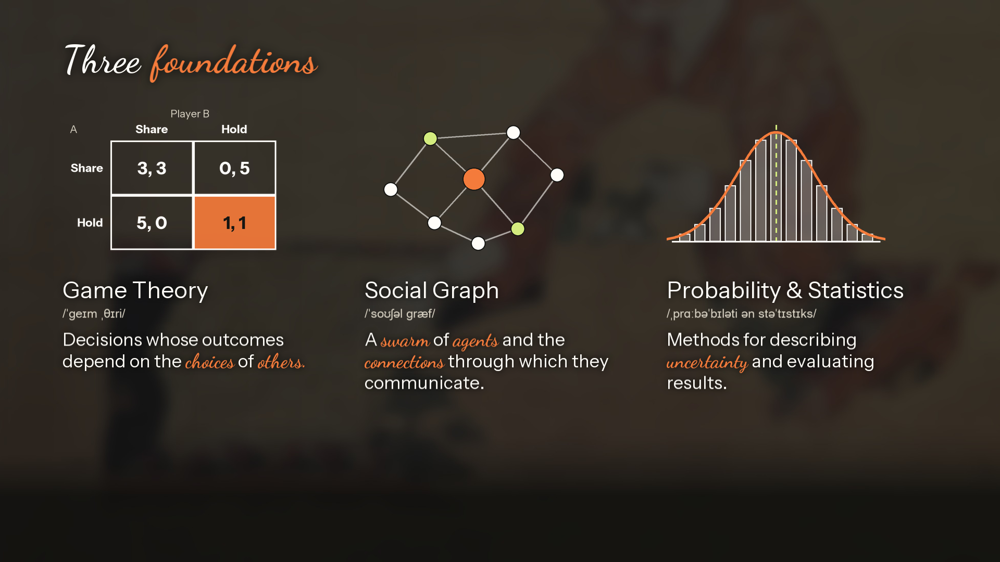
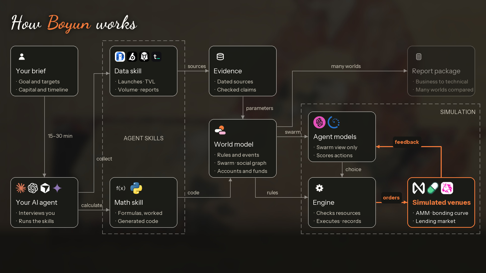
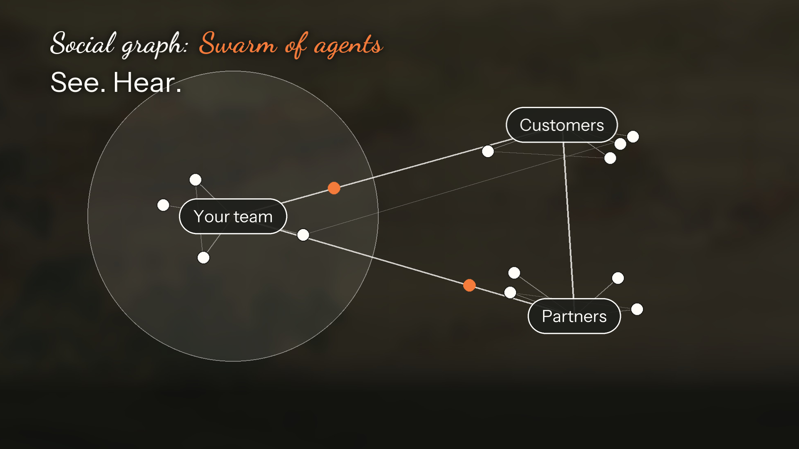
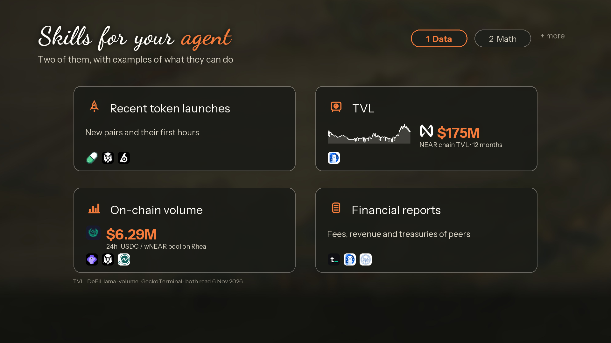
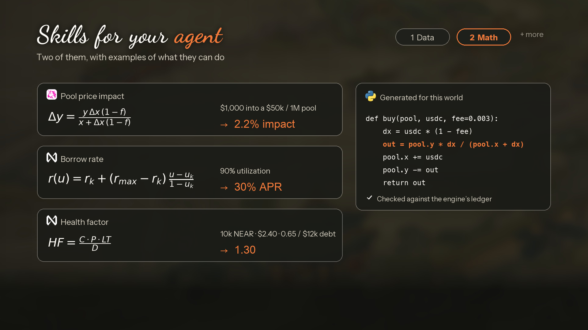
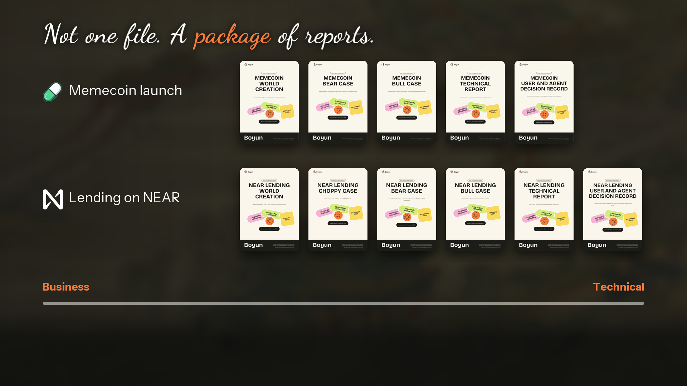
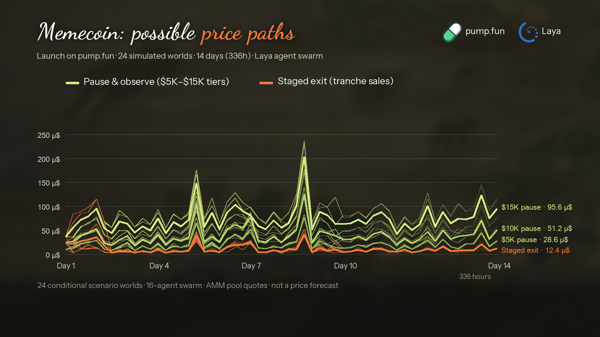
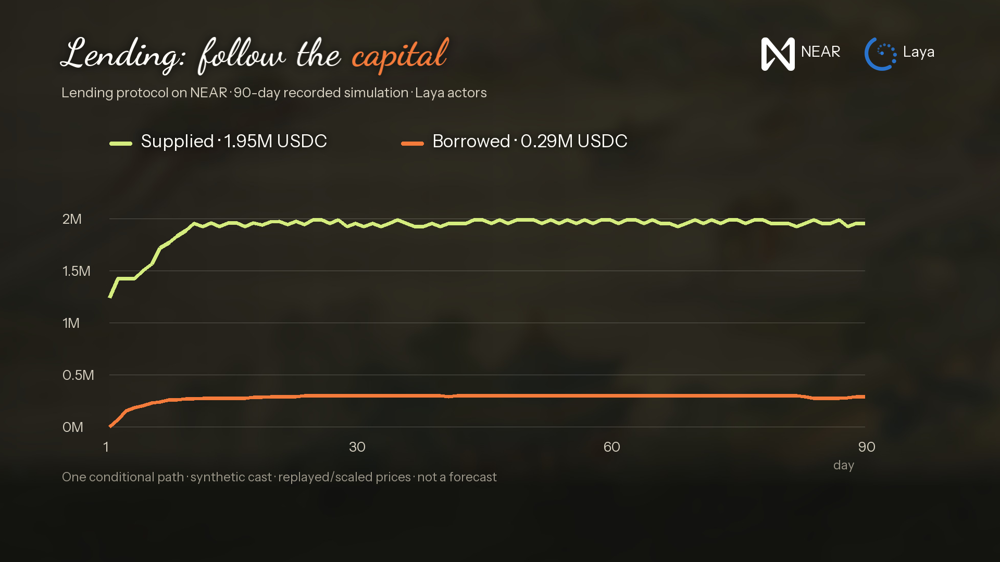

<div align="center">


</br>

**拨云见日 · Clarity Before You Commit**
</br>
<em>A Self-Hosted Agent Swarm Simulation Engine for Financial and Economic Decisions</em>

[](LICENSE)
[](https://www.python.org/)
[](docs/decision-lab/LOCAL_ACTOR_MODEL.md)
[](docs/decision-lab/MCP_AGENTS.md)
[](docs/decision-lab/NEAR_TECH_GUIDE.md)
[](Dockerfile)

[Website & Demo](https://boyun-protocol.github.io/) · [Research Paper](docs/whitepaper/main.pdf) · [Technical Article & Guide](docs/decision-lab/BOYUN_TECHNICAL_ARTICLE.md) · [Boyun-core](https://github.com/Boyun-Protocol/Boyun-core) · [Boyun-interface](https://github.com/Boyun-Protocol/Boyun-interface) · [Boyun-skills](https://github.com/Boyun-Protocol/Boyun-skills) · [Install Guide](docs/INSTALL.md)

</div>

---

## ⚡ Overview

Inspired by **[MiroFish](https://github.com/666ghj/MiroFish)**, **Boyun** (拨云, *"part the clouds"*) is a self-hosted **Agent Swarm simulation engine** for financial, economic, and strategic decisions. Modeled actors operate as autonomous **agents** communicating across a directed **Social Graph**, while deterministic ledgers enforce budgets, AMM/bonding-curve pricing, and lending liquidation rules in code.

> **You provide:** A decision question, market context, and the policy alternatives to compare.</br>
> **Boyun returns:** An audited Agent Swarm world, replayable trajectories across Strategic, Market, and Lending ledgers, and a 5-report research package.

<div align="center">

</div>

- **Game Theory**: Explicit preference weights, utility functions, budgets, and joint-action couplings.
- **Social Graphs**: Directed information graphs governing observation boundaries and message propagation across the swarm.
- **Probability & Statistics**: Exact Bayesian belief updating, seeded Monte Carlo batches, and Brier / log-loss scoring.

---

## ⛓️ NEAR Ecosystem Integrations

Boyun integrates deeply across the NEAR protocol, wallet, and AI stack (spanning deployed contracts, runtime adapters, and architectural specs in [NEAR Tech Guide](docs/decision-lab/NEAR_TECH_GUIDE.md) & [NEAR MVP](docs/decision-lab/NEAR_MVP.md)):

| NEAR Layer | Integration in Boyun | Status |
| :--- | :--- | :--- |
| **NEAR Smart Contract Registry** | Rust (`near-sdk 5.29.1`) contract on `csl-registry-2e4069fc870d.testnet` anchoring salted SHA-256 simulation digests with code-hash pinning and RPC finality checks ([lib.rs:42](contracts/commitment-registry/src/lib.rs#L42)<!-- code:contract -->, [near_registry.py:147](engine/src/decision_lab/near_registry.py#L147)<!-- code:verify -->) | **Deployed & Verified** |
| **NEAR Wallet Selector (Intear)** | Browser wallet connection, wallet-specific commitment plans, CSP/origin guards, and operator testnet relay ([product_near.py:69](engine/src/decision_lab/product_near.py#L69)<!-- code:wallet -->) | **Implemented** |
| **NEAR AI Cloud Adapter** | Pin-verified `NearAITextModel` world-authoring connector (`/v1/chat/completions` & `/v1/models`, `x-no-aliasing: true`, zero silent fallback) ([near_ai.py:168](engine/src/decision_lab/near_ai.py#L168)<!-- code:cloud -->) | **Implemented** |
| **NEAR Confidential GPU TEE & E2EE** | Architectural specification for Confidential TEE model attestation, TLS binding, and client-side E2EE world authoring ([DCML Foundations](docs/decision-lab/NEAR_RESEARCH_FOUNDATIONS.md)) | **Architecture Draft** |
| **NEAR On-Chain RPC & DeFi Engine** | Frozen NEAR RPC account/pool grounding ([near_demo.py:58](engine/src/decision_lab/near_demo.py#L58)<!-- code:near_case -->), NEAR TVL & Rhea DEX data skills, and a 90-day native NEAR collateralized lending simulation | **Implemented** |
| **NEAR Intents (1Click & Confidential)** | Post-simulation `dry: true` liquidity/funding route quotes and Confidential Intents treasury settlement for selected policy branches | **PoC / Spec Draft** |
| **NEAR Chain Signatures (MPC)** | Constrained foreign-chain policy execution authorized by a NEAR account after simulation review | **Architecture Draft** |
| **NEAR Agent Market & IronClaw** | Self-hosted simulation worker specification accepting marketplace research briefs and delivering verified 5-report packages | **Architecture Draft** |

---

## 📸 Architecture & Visual Showcase

<div align="center">

</div>

<div align="center">
<table>
<tr>
<td width="50%"></td>
<td width="50%"></td>
</tr>
<tr>
<td align="center"><b>Social Graph & Agent Swarm</b></td>
<td align="center"><b>Empirical Data Grounding Skill (NEAR TVL & Rhea DEX)</b></td>
</tr>
<tr>
<td width="50%"></td>
<td width="50%"></td>
</tr>
<tr>
<td align="center"><b>Mathematical Mechanism Verification Skill</b></td>
<td align="center"><b>5-Report Analytical Package</b></td>
</tr>
<tr>
<td width="50%"></td>
<td width="50%"></td>
</tr>
<tr>
<td align="center"><b>Market Ledger: 24-World Price Paths (136K+ Laya Decisions)</b></td>
<td align="center"><b>Lending Ledger: 90-Day NEAR Collateral & USDC Simulation</b></td>
</tr>
</table>
</div>

---

## 🔄 Workflow

1. **Ground the World**: Pull dated on-chain data and verify protocol math via MCP and `Boyun-skills`.
2. **Specify Swarm & Graph**: Define the decision question, agent personas, preference weights, affordable menus, and directed Social Graph ([strategic_worlds.py:85](engine/src/decision_lab/strategic_worlds.py#L85)<!-- code:world_validate -->).
3. **Score Bounded Choices**: Build hashed per-agent observations ([strategic_worlds.py:255](engine/src/decision_lab/strategic_worlds.py#L255)<!-- code:world_observe -->) and score actions locally with `Laya` (zero API fee) or hosted `Jev` ([jev.py:209](engine/src/decision_lab/jev.py#L209)<!-- code:jev -->).
4. **Settle Deterministically**: Execute atomic transitions on the Strategic ([strategic_worlds.py:287](engine/src/decision_lab/strategic_worlds.py#L287)<!-- code:world_advance -->), Market AMM ([finance.py:182](engine/src/decision_lab/finance.py#L182)<!-- code:amm -->), or Lending ledger ([finance.py:93](engine/src/decision_lab/finance.py#L93)<!-- code:ledger -->).
5. **Replay & Commit on NEAR**: Verify bit-identical offline replay ([strategic_worlds.py:339](engine/src/decision_lab/strategic_worlds.py#L339)<!-- code:world_replay -->), export the 5-report package, and anchor a salted SHA-256 commitment on NEAR testnet ([integrity.py:44](engine/src/decision_lab/integrity.py#L44)<!-- code:commitment -->).

---

## 🧩 Repositories

| Repository | Description |
| :--- | :--- |
| **[Boyun-core](https://github.com/Boyun-Protocol/Boyun-core)** | Python simulation engine, Strategic/Market/Lending ledgers, `Laya`/`Jev`/`NEAR AI` adapters, CLI, API, MCP server, and NEAR commitment contract |
| **[Boyun-interface](https://github.com/Boyun-Protocol/Boyun-interface)** | Browser workbench UI, interactive scenario & replay inspector, and Intear NEAR testnet wallet bundle |
| **[Boyun-skills](https://github.com/Boyun-Protocol/Boyun-skills)** | First-party `boyun-world-grounding` and `boyun-financial-reports` skill packs for coding agents |

---

## 🚀 Quick Start

Requires **Python 3.11+** and **[uv](https://docs.astral.sh/uv/)**.

```bash
# 1. Install core engine
uv sync --project engine --extra pdf --dev

# 2. Run a guided CLI simulation (offline deterministic baseline)
uv run --project engine --extra pdf decision-lab journey \
  --offline --format both --output-dir engine/output/first-journey

# 3. Launch the Browser Workbench (with Boyun-interface cloned beside Boyun-core)
uv run --project engine --extra pdf --with-editable ../Boyun-interface \
  decision-lab serve --port 8769

# 4. Run the MCP Server for Claude, Codex, Cursor, or Cindy
uv run --project engine --extra mcp decision-lab mcp --workspace engine/output/mcp
```

### Verification & Tests

```bash
uv run --project engine --extra pdf --with-editable ../Boyun-interface python -m pytest engine/tests tools/tests -q
python3 tools/build_evidence_docs.py --check
cargo test --locked --manifest-path contracts/commitment-registry/Cargo.toml
```

**Docs:** [Technical Article & Guide](docs/decision-lab/BOYUN_TECHNICAL_ARTICLE.md) · [System Design](docs/decision-lab/SYSTEM_DESIGN.md) · [Research Foundations](docs/decision-lab/RESEARCH_FOUNDATIONS.md) · [NEAR MVP](docs/decision-lab/NEAR_MVP.md) · [NEAR Tech Guide](docs/decision-lab/NEAR_TECH_GUIDE.md) · [Source Map](docs/decision-lab/SOURCE_MAP.md) · [Paper (PDF)](docs/whitepaper/main.pdf)

---

## 📄 License & Attribution

Released under [AGPL-3.0-only](LICENSE). Inspired by **[MiroFish](https://github.com/666ghj/MiroFish)** and **[OASIS](https://github.com/camel-ai/oasis)**; see [NOTICE](NOTICE) and [Upstream Reuse](docs/decision-lab/UPSTREAM_REUSE.md). Outputs are conditional scenario explorations under declared assumptions, not calibrated market forecasts.
