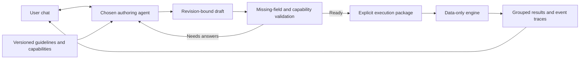

# Agent-authored scenarios: implemented core boundary

The chat agent owns questions, research, field creation, persona creation and
rule proposals. The core consumes structured inputs, validates them and executes
supported mechanics. It never chooses a model or generates personas mid-run.

Updated 24 October 2026: this boundary is available in Python/CLI and the default
**Studio** browser workspace at port 8769. Studio renders draft-specific fields,
reviews supplied personas/rules, runs actual packages and plays declared choice
worlds. It exports requests to the user's own agent and imports revision-bound
responses. Product chat and a direct provider connection remain pending.

The choice/Studio increment passes 1,009 Python tests plus 42 subtests and
20 JavaScript regression checks, browser flows and isolated installed-wheel
acceptance. See `PROGRESS.md` for the evidence and remaining boundaries.
Historical example and Gemini-pilot evidence below retains its original scope.



## What now executes

| Module | Actual calculation | Important boundary |
| --- | --- | --- |
| `event-chain.v1` | Supplied categorical event rules, conditional dependencies, integer metric effects, path frequency and metric statistics | Descriptions do not generate behavior; no financial ledger or learned audience model |
| `choice-world.v1` | Finite scene choices, bounded integer metrics, requirements, atomic effects, seeded outcomes, replay/fork and explicit-policy batch statistics | Planning/scenario metrics; no financial ledger, autonomous persona reasoning or equilibrium search |
| `explicit-launch.v1` | Existing single-asset launch mechanics using caller-supplied actors, cash and rule settings | Fixed launch action vocabulary; no persona-library sampling, lending or imported policy bundle in this adapter |

The original `decision-lab run`, checkpoint APIs and workbench retain their old
behavior. The explicit adapter has its own input/output versions. A generic
event package is not silently converted to the launch profit equation.

## Commands

From the repository root, choose output paths that do not exist:

```sh
# Discover accepted actions, field shapes and hard limits.
uv run --project engine decision-lab scenario capabilities \
  --output engine/output/scenario-capabilities.json
uv run --project engine decision-lab scenario guidelines \
  --output engine/output/scenario-guidelines.md

# Export messages for any user-selected authoring agent. This sends nothing.
uv run --project engine decision-lab scenario prepare \
  --input engine/examples/scenario-draft.empty.v1.json \
  --model your-selected-agent --output engine/output/authoring-request.json

# Apply an externally generated revision-bound response.
# Supply actual files for these two placeholders; no response is generated here.
uv run --project engine decision-lab scenario apply \
  --input path/to/current-draft.json --response path/to/agent-response.json \
  --output engine/output/updated-draft.json

# Compile a completed draft; missing fields produce diagnostics, not guesses.
uv run --project engine decision-lab scenario validate \
  --input engine/examples/ticker-evaluation-draft.v1.json \
  --output engine/output/ticker-validation.json

# Execute the reviewed draft or a complete raw package without any chat process.
uv run --project engine decision-lab scenario run \
  --input engine/examples/defi-stress-draft.v1.json \
  --worlds 100 --seed 42 --output engine/output/defi-stress-result.json
uv run --project engine decision-lab scenario run \
  --package engine/examples/launch-explicit.v1.json \
  --worlds 25 --seed 42 --output engine/output/explicit-launch-result.json
uv run --project engine decision-lab scenario run \
  --input engine/examples/choice-world-draft.v1.json \
  --worlds 100 --seed 42 --output engine/output/choice-policy-result.json
```

All artifacts are local exclusive mode0600 writes. `validate` saves its diagnostic
result even when not ready; `run` refuses an incomplete draft and removes its
own empty reservation. CLI errors do not echo supplied data. There is no network,
model transport, wallet signing or public publication in these commands.

Python consumers use `scenario_authoring.compile_draft`, `run_package`,
`prepare_authoring_request` and `apply_authoring_response`. The underlying
`event_chains.run_event_chain`, `choice_worlds.run_choice_policy` and
`explicit_cast.simulate_explicit` take explicit
module inputs directly. A single `run_package` report is self-contained with
`execution_input`, package hash, seed/world count, Python version, engine source
fingerprint and a hash binding that run identity. Hashes identify bytes/code;
they do not authenticate sources or scientifically validate the model.

## Dynamic fields and unresolved values

Drafts use `scenario-draft.v1` with exactly:

```json
{
  "schema_version": "scenario-draft.v1",
  "id": "user-decision",
  "revision": 0,
  "event_description": "The user's decision and intended outputs",
  "fields": [],
  "engine_input": null
}
```

The agent proposes fields relevant to that situation. Each field has `id`,
`label`, `type`, `unit`, `required`, `value`, `minimum`, `maximum`, `choices`,
`target`, `why` and `provenance`. Supported types are integer, text, boolean and
string choice. Provenance declares status, rationale and source references.
Integer money must state its unit, for example cents rather than dollars.

`target` is a JSON pointer to an existing object leaf inside `engine_input`,
such as `/parameters/stress_bps`, or null for informational context. It cannot
create arbitrary paths, edit identity, replace arrays or execute expressions.
Persona/event-list changes are full agent-authored package revisions, not a
numeric field patch. A non-null mapped value is authoritative; the compiler
applies it to a copy and then validates the resulting package. Coupled values
such as complementary probabilities must all be supplied consistently.

Null means unfilled. A required context field or any mapped executable null
blocks the package. An optional context-only null is allowed and has no effect.
The compiler never reuses a hidden old value for a visibly empty mapped field.
Unknown actions/modules are rejected. A ready package has no missing executable
values; passing validation is not permission to invent mechanisms.

An authoring response has exactly `schema_version` =
`scenario-authoring-response.v1`, `base_revision`, `base_sha256` and `draft`.
It must reference the exact current draft/hash, retain its ID, and advance the
revision by one. Stale responses cannot overwrite newer edits. Incomplete drafts
can be retained, but malformed field/envelope shapes are rejected; executable
module validation is required before readiness. Diagnostic display is capped
at 64 issues while `draft_valid` still tracks invalid fields beyond that cap.

## Custom personas and more detail

The authoring agent can accept the user's own personas, select a smaller cast,
or focus on particular roles. The launch input format is `explicit-cast.v1`:
an explicit actor list and exclusions, optionally per-slot alternatives and the
declared `independent_per_actor_per_world` mixture assumption. Existing Actor
fields specify ID/template reference, category, owner, initial cash, capabilities,
subscriptions, position limit, entry fraction, attention capacity, strategy and
provenance. Descriptions may be supplied in provenance; a template ID is a
declared reference, not a library lookup during execution.

For each selected slot, alternatives have IDs, weights summing to 10,000 bps and
supported overrides: strategy, entry fraction, position limit, attention or
subscriptions. Exactly one alternative executes for that same funded slot in
each world. Neither actor count nor endowment increases. Adding actual actors
or changing funding is a separate explicit package edit.

`launch-explicit.v1.json` has six actors and two strategies for one large-holder
slot. It was authored/exported once outside execution. The engine does not rerun
the library generator. Owners are unique outside the explicit shared project
founder/LP case, preventing cash overwrite or duplicated endowments. Unavailable
strategies/actions are rejected, rather than accepted as biographies and quietly
left passive. Existing passive roles are labelled as such.

Reports label the cast as base-before-variants. Each world's variant selection
includes effective policy settings for changed slots, so the displayed base
strategy cannot be mistaken for the executed alternative. This launch adapter
does not yet accept arbitrary strategic formulas, template policy bundles,
multi-venue trading or an equilibrium solver. These need separate capabilities.

## Event rules and probability

The event-chain schema declares parameters, personas, metrics, horizon, rules
and assumptions. Each rule names a capable actor, tick, optional prerequisites,
categorical outcomes and probability provenance. Outcomes contain probabilities
and `adjust_metric` effects. A probability/delta is an integer literal or an
explicit parameter reference. Every outcome set must total 10,000 bps.

Dependencies require a named outcome from a strictly earlier tick. Unmet
dependencies skip a rule; AND prerequisites are supported. Separate eligible
rules use named independent draws conditional on the declared prerequisites.
To express a shared shock, branch on a common earlier rule. Separate percentages
do not establish arbitrary correlation. Equal-time rules are ordered by ID and
their additive metric effects are applied atomically within each outcome.

Validation covers types, references, probability sums, cycles/time order, metric
magnitudes, actions and workload/output limits before rollout. The launch adapter
also bounds repeated feed scans, not just actor visits. All validators are
bounded; limits and supported fields are available from `scenario capabilities`.

The authoring guidelines explain players, incentives/payoffs, information sets,
causal mechanisms, conditional probability, independence, uncertainty, sampling
bias, calibration and no-action/adverse alternatives. They constrain model
proposals; they are **not** an implemented game-theory solver or proof that a
scenario reproduces the real world. Empirical validation remains separate.

## Choice worlds and Studio

A choice package supplies parameters, personas, bounded metrics, scenes,
initial scene, ordered policy and assumptions. Each choice names a capable actor,
requirements, immediate metric effects, mutually exclusive outcomes and declared
probability provenance. Outcome probabilities total 10,000 bps. Only the published
`adjust_metric` action executes; descriptions remain context.

Eligibility checks current requirements and whether the immediate effects and
all positive-probability outcomes fit the declared metric bounds. An impossible
choice stays disabled; it cannot spend points and then reroll a rejected event.
Batch execution tries the supplied choices in order. Exhausting that policy
counts the world as blocked, even if an unlisted choice would be eligible. Every
requested world remains in status counts, path frequencies and metric summaries.

Studio includes four examples across the three modules: ticker rubric, declared
stress, explicit launch and product-release choices. The ticker and stress forms
come from different draft fields; the explicit launch example supplies a complete
package for inspection/import or advanced JSON editing. Persona and variant
panels expose supplied behavior, including the same funded-slot boundary.

An edit invalidates earlier validation and marks retained results as previous.
An external response must bind the current revision and hash. The form does not
call an agent; the exported messages carry the guidelines, capabilities and draft
to the user's selected authoring tool. See WORKBENCH.md for the
browser walkthrough and [INTERACTIVE_WORLD.md](INTERACTIVE_WORLD.md) for stepping,
immutable history, snapshot restore and fork commands.

## Historical examples and model pilot, 24 October 2026

- Ticker example: NOVA 82 vs MOSS 74 **declared rubric points**, computed from supplied
  criteria. There is no measured audience preference, name clearance or adoption
  probability. Repeating this deterministic rubric does not add evidence.
- DeFi example: supplied stress/severity branches produce declared loss values
  of 0/10,000/40,000 and a health indicator. The 100-world seed 42 run produced
  80 baseline, 11 contained stress and 9 severe paths. Mean declared loss 4,700,
  median 0. Those figures reflect the configured illustrative assumptions, not
  cash settlement, liquidation mechanics or a real risk estimate.
- Launch example: six explicitly funded actors and one large-holder slot with
  two alternatives executed 25 worlds; all worlds conserve the ledger totals.

An actual Gemini `gemini-3.8-flash-high` development CLI call took 70.478 s and
returned a valid authoring response. It created four relevant parameter fields
and a required unfilled protocol question. The validator blocked execution.
After an explicitly fictional test answer was supplied outside the core, the
same package validated and ran 100 worlds. The CLI reported 11,076 input and 9,343
output tokens, including 7,192 thinking tokens in that output accounting.
Billing and model identity are not independently verified. One development
request was made, with no retry; rollouts made zero inference calls.

Private requests, response, compilation, report and receipt are kept in ignored
`engine/output/scenario-authoring-pilot/`. This is a development acceptance pilot,
not an embedded live chat service or evidence that model-generated rules forecast
better. The browser does not send prompts to Gemini or another provider here.

## Remaining integration

Three executable modules, four browser examples, dynamic field rendering,
persona/rule inspection, request/response review and the declared choice loop are
implemented. Conversational authoring and a user-selected provider/session
adapter remain product work. Persona/rule structural changes currently arrive
through a complete authored draft or JSON editing; biographies do not generate
new runtime strategies. Financial stepping, more venues/protocols, richer
strategies and observed-persona calibration need their own mechanics and tests.
See CORE_ROADMAP.md for priorities, technology and acceptance
blockers. No external account is required for the current offline increment.

NEAR publication remains separate. Package/result hashes can later be committed
with a private salt; no chain action is sent here. Intents is not encryption.


## Live model world construction and communication

The subsequent integration adds an actual model-backed world builder and isolated
actor turns through `decision-lab agents simulate`. This is separate from the
three offline modules described above. It consumes protected resource slots,
constructs personas/information links through the selected model, and executes
peer communication plus constrained market actions using the existing ledger.
The real Gemini pilot completed construction plus six role calls, and a separate
one-call probe settled a model-proposed synthetic trade. No UI work was added.
Architecture, actual evidence and CLI commands: LIVE_AGENT_WORLD.md.
