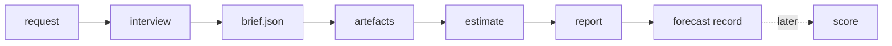

# Agent guide — producing a case report

How an agent turns a decision request into the five-document report. This is the operating
procedure; the document structure itself is in [REPORT_STRUCTURE.md](REPORT_STRUCTURE.md).

Apply [the shared evidence standard](SIMULATION_EVIDENCE_STANDARD.md) to every
simulation type. Trace every material input through its mechanism to each reported
outcome, using a specific reference or a reasonable documented causal hypothesis.
The same requirement covers persona behavior, probabilities and qualitative rules.

Apply [the report depth standard](REPORT_DEPTH_STANDARD.md) before publication:
world-level statistics, consolidated accounting, executed-plan evidence, quantified
findings with falsification checks, and explicit tested/untested edge-case coverage.
Do not substitute model-call count for statistical sample size or claim that
report length establishes an advantage over MiroFish.

## 1. Decide who owns which choice

| The user decides | The agent decides |
|---|---|
| capital, bootstrap size, creator budget | curve arithmetic and sampling |
| cast size and mix, thresholds, decay, exit shape | figure design and document layout |
| whether to compare or recommend | how unknowns are labelled and swept |
| the answer when a number is unknown | which sensitivity arms to run |

Never move a user choice into the agent column because it is easier to implement.

## 2. Run the interview

- Two or three questions per round, each with concrete options and the tradeoff inside the option.
- Plain language. A question containing sampling jargon ("population") is a defect: rephrase it.
- Record each answer **verbatim** and keep the interpretation in a separate field. Never paraphrase
  an answer into a decision the user did not make.
- When an answer exposes a missing capability, say so and build it; do not silently approximate.
- Unknown values stay unknown. If a run needs one, either ask or declare it as a labelled arm and
  sweep it.

## 3. Write the brief

`<case>/brief.json`, schema `case-brief.v1`:

| Field | Meaning |
|---|---|
| `id`, `question` | stable case identity and the decision being tested |
| `labels` | title, venue, decision, currency unit used in document headings |
| `artefacts` | relative paths to probabilities, cast, launch cases, bootstrap, events |
| `estimate` | worlds, seed, SOL price, decay half-life, bootstrap, creator budget and allocation |
| `sensitivity` | the parameter grid and worlds per arm |
| `interview_files` | the recorded answer files, in order |

`decision-lab case validate --case <dir>` checks the brief and that every named artefact exists.

## Venues

| `estimate.venue` | Means | Required parameters |
|---|---|---|
| `curve` | fair launch on a bonding curve that migrates into a pool | `bootstrap_usd`, `sol_usd`, `kol_supply_bps` |
| `pool` | token already trades in a constant-product pool the team funded | `pool_supply_bps`, `founder_supply_bps`, `bootstrap_usd` as the deposit |

The prose, the venue-facts table and the scenario grouping switch on this field: a pool case has no
curve phase, so it has no migration split and no bootstrap share. Adding a third venue means a branch
in `estimate_launch` and in the document functions, plus a regression case alongside the two that
exist.

## 4. Build the artefacts, in order

### Dynamic timeline requests

Follow [Dynamic event worlds](DYNAMIC_EVENT_WORLDS.md) when the user requests an
evolving actor timeline. Research sourced calendars and a justified six- or
twelve-month historical cohort, record as-of availability, plan repeated hourly
actor decisions using current state, and use finer steps during launch. Derive
market events from settlement and conditional external-event models. Persist
trajectories, visibility, receipts, failures and costs before rendering a DAG or
time-series report. Quiet periods are legitimate; arbitrary periodic spikes are not.

The five static artefacts below do not fulfill that runtime requirement. Explicitly
report missing scheduler/venue/evidence integration. Do not resample one actor
decision vector and describe it as fresh hourly behavior, increase engine bounds,
or make uncapped model calls. Graph complexity comes from supported interactions,
not invented event odds. Preflight the complete pilot before asking to run it.

1. **Evidence pack** — dated captures, with what each may and may not be used for.
2. **Launch cases** — expressed relative to pool liquidity, weighted by count and by liquidity.
3. **Cast** — actor archetypes with capital as a multiple of liquidity and explicit information rights.
4. **Probabilities** — one typed Jev call per trading actor, receipts kept, spend capped.
5. **Estimate** — `launch_estimate.py`, deterministic given seed and probabilities.

Then `decision-lab case build --case <dir>` renders the documents, figures and data.

Add `--public` for the edition that may leave the machine: it uses `labels_public` from the brief,
drops the interview record, the event calendar, the source list and the whole `DATA/` directory, and
anonymises cast labels. Identity lives in the brief, so a public export cannot leak it by accident.
Every build also writes `report.html`, one self-contained page with the documents and inline figures.
Its section navigation works offline, wide tables scroll on small screens, and printing
uses a simplified layout. The figures and their underlying assumptions are unchanged.

## 5. Hold the document bar

- Simulated frequencies use the actual world denominator, such as "three of four".
  Do not pad samples to 100 or disguise unknown real-world odds with an icon array.
- One page for the decision document; four findings maximum.
- Every figure regenerates from `DATA/`; a hand-built chart is a defect.
- A scenario row states its conditional outcome, evidence basis and uncertainty;
  unknown odds or unsupported tail estimates remain explicitly unavailable.
- "Do nothing" is always a row, and if the model loses to it, that is the first sentence.
- Unknowns print as unknowns; an absent input never becomes zero.
- The model document lists what could falsify it and what was actually tested.

## 6. Close with a forecast record

`04-FORECAST.md` states the claim, the resolution criteria, the date and the status. Later runs
append the realised outcome and a Brier score. Without this the report is marketing; with it, the
product can eventually say whether its estimates were any good.

## 8. Presentation delivery

The same data also becomes a deck, and the deck is generated, not retyped. We use
[ppt-master](https://github.com/hugohe3/ppt-master) (MIT) in its Quick profile: one pass, no spec
file, native PPTX output.

1. Clone it outside the repo and install its export dependencies in its own venv
   (`python-pptx`, `skia-pathops`, `uharfbuzz`, `XlsxWriter`, `PyYAML`).
2. `project_manager.py init <name> --quick-generate`, then import the rendered `report/` folder.
3. Author `svg_output/NN_name.svg` pages, each `viewBox="0 0 1280 720"`, `lang`, one
   `data-pptx-page-role` on the root, every root `<g>` carrying `data-pptx-bounds`, and one
   `font-family` on the root. Numbers come from `report/DATA/outputs.json`.
4. `svg_quality_checker.py <project> --quick-generate --canonical-authoring --stage final --json`
   must report zero blocking findings; its measured text widths are the authority, not the eye.
5. `svg_to_pptx.py <project> --quick-generate --no-notes` writes the native deck.

Deck rules: one message per slide, at most nine slides, odds as "22 of 100", the do-nothing row on
the comparison slide, and the forecast record as the closing slide so the audience sees what is
being claimed. Keep the deck beside the report in the case folder with its SVGs, because the SVGs
are the source and the PPTX is the export.

## 7. Publish checklist

- [ ] Brief validates; every artefact path resolves.
- [ ] Interview table present, with verbatim answers and separate interpretations.
- [ ] Numbers in the documents match `DATA/outputs.json`.
- [ ] Figures inspected after rendering, not only parsed.
- [ ] Limits named in the document that makes the claim, not only in the appendix.
- [ ] Claim recorded with resolution criteria before anyone reads the result as a prediction.

## Failure modes already seen

| Failure | Lesson |
|---|---|
| Curve buys priced from initial reserves instead of current ones | port a throwaway script into a tested module before trusting a single number |
| Creator allocation counted twice (1.5% per actor instead of 0.75%) | assert the invariant, not the intention |
| Pipe characters inside answers breaking Markdown tables | escape cell content at render time |
| A case with no whale worlds crashing the renderer | every outcome class must render as zero, not fail |
| Half-life arms identical because no buyers arrive after the cast | a sensitivity that does not move is a finding about the model, state it |
