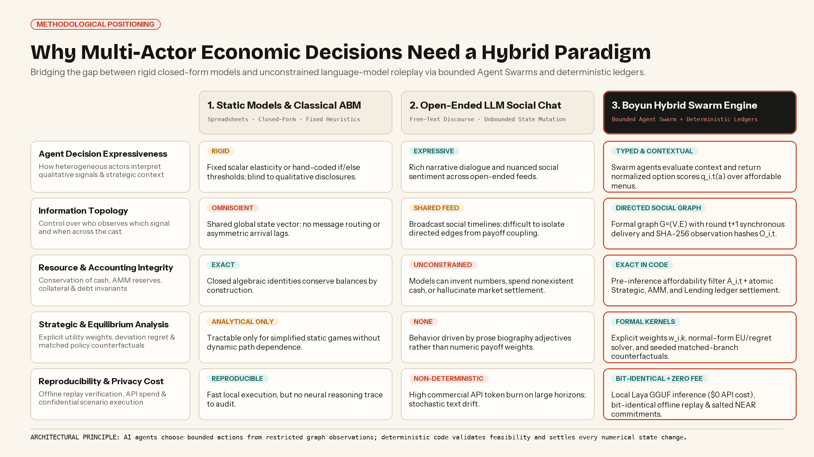
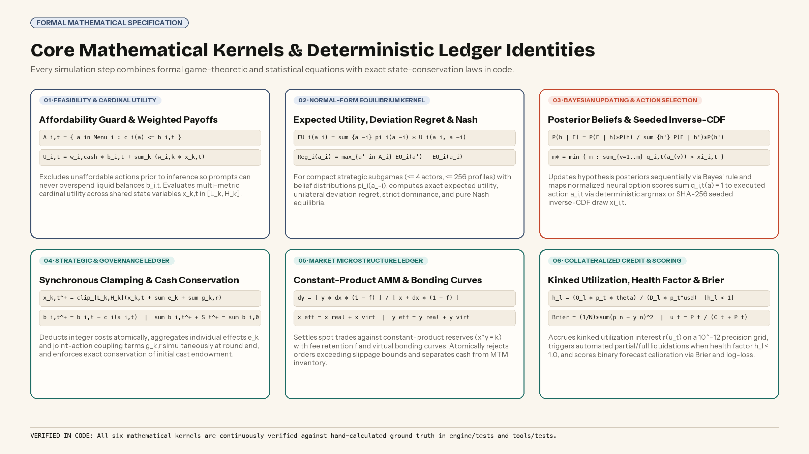
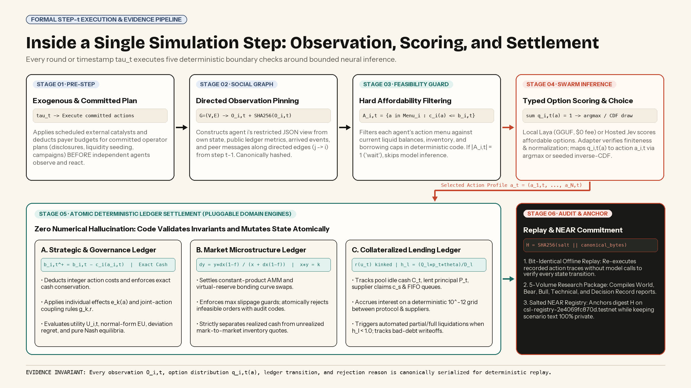
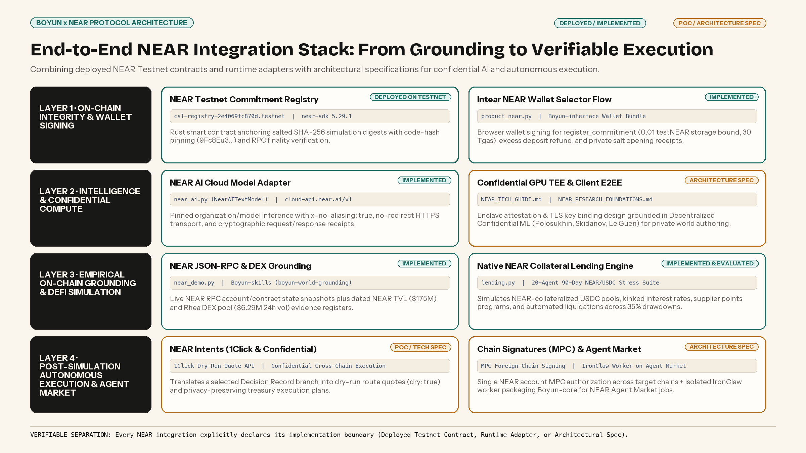

# Boyun (拨云): A Self-Hosted Agent Swarm Simulation Engine for Financial, Economic, and Strategic Decisions on NEAR

**Subtitle:** How bounded Agent Swarms, Directed Social Graphs, and deterministic domain ledgers bridge the gap between static spreadsheets and unconstrained LLM roleplay.  
**Author:** Cherry Q  
**Website & Interactive Demo:** [https://boyun-protocol.github.io/](https://boyun-protocol.github.io/)  
**Research Paper:** [Boyun: Multi-Agent Simulation for Financial and Economic Decisions](../whitepaper/main.pdf)  
**X Articles Rich-Text Composer Page (1-Click Copy & Paste):** `docs/decision-lab/launch/BOYUN_X_ARTICLE.html`  
**X Articles Draft.js Schema JSON:** `docs/decision-lab/launch/BOYUN_X_ARTICLE_DRAFTJS.json`  

> **Format Note for X Articles (`x.com/compose/articles`):** X Articles uses a **Draft.js Rich Text (WYSIWYG) editor**, not Markdown. It supports `header-two` subheadings, short `unstyled` body paragraphs, `Bold`, `Italic`, `LINK` entities, `ordered-list-item`, `unordered-list-item`, `blockquote`, `code-block`, `DIVIDER`, and `MEDIA` image blocks—and does **not** render LaTeX (`$$...$$`) or Markdown `| tables |`. Every section below is structured in exact X Article block order using native **Unicode mathematical notation** (`Aᵢ,ₜ`, `Oᵢ,ₜ`, `qᵢ,ₜ(a)`, `bᵢ,ₜ`, `Uᵢ,ₜ`, `h_ℓ`, `μ$`) and visual diagram blocks.


Evaluating high-stakes decisions in multi-actor economic, financial, and institutional systems requires modeling how heterogeneous participants dynamically respond to policy interventions, external shocks, and one another under uncertainty.

Yet existing computational tools force decision-makers into an artificial trade-off between two flawed extremes: **static spreadsheets and closed-form equilibrium models**, which enforce accounting identities but compress strategic human adaptation into fixed scalar assumptions; and **unconstrained language-model social chats**, which generate expressive dialogue but permit models to ignore budget limits, invent balances, and hallucinate settlement.

Inspired by [MiroFish](https://github.com/666ghj/MiroFish) and the [OASIS](https://github.com/camel-ai/oasis) multi-agent simulation paradigm, **Boyun** (拨云, *bō yún* — "parting the clouds", from the classical idiom 拨云见日) introduces a hybrid computational architecture on [@NEARProtocol](https://x.com/NEARProtocol) that unifies **autonomous Agent Swarm reasoning** with **deterministic state accounting**.

> Core Architectural Principle: In Boyun, AI agents choose bounded actions from restricted Social Graph observations; deterministic code validates feasibility and settles every numerical state change.

Built on three formal pillars—**Game Theory**, **Directed Social Graphs**, and **Probability & Statistics**—Boyun executes scenarios across pluggable domain ledgers (**Strategic & Governance**, **Market Microstructure**, and **Collateralized Credit**), runs tens of thousands of typed agent decisions locally on consumer hardware via the open-weight **Laya** model at $0 API cost, and integrates across the [@near_ai](https://x.com/near_ai) and NEAR Protocol stack.

---

## Why Multi-Actor Economic Decisions Need a Hybrid Paradigm

Why do well-specified economic policies, treasury allocations, governance disclosures, and mechanism designs frequently diverge from pre-deployment projections? Across financial and institutional systems, macro-level outcomes rarely depend on a single operator acting against a passive background.

Instead, real-world outcomes emerge from coupled, path-dependent interactions among heterogeneous actors operating under three simultaneous constraints:

1. **Strategic Coupling and Feedback.** An institutional participant's willingness to commit capital, endorse a governance proposal, or supply liquidity depends on how peer actors, competitors, and independent analysts respond—and whether their combined actions cross critical system thresholds.

2. **Asymmetric Information and Propagation Lags.** Market participants do not observe a shared, omniscient state vector. Disclosures, catalysts, and peer signals propagate across specific communication channels with measurable arrival delays.

3. **Hard Conservation and Feasibility Limits.** No economic actor can spend cash exceeding liquid balances, execute trades without shifting Automated Market Maker (AMM) reserve curves, or maintain undercollateralized debt below liquidation health thresholds without triggering liquidator intervention.


*Methodological Comparison: Static Models vs. Open-Ended LLM Social Chat vs. Boyun Hybrid Swarm Engine.*

Classical agent-based models (ABMs) enforce hard accounting rules, but rely on rigid *if/else* thresholds or fixed elasticities that cannot interpret qualitative disclosures or shifting strategic narratives.

Conversely, open-ended LLM social simulators allow dozens of personas to converse over a shared feed, but conflate narrative intention with numerical state. An agent writing *"I commit $100,000 to support the reserve"* in a chat log does not deduct cash, update pool reserves, accrue interest, or conserve balances.

Boyun resolves this bottleneck by pairing MiroFish's world-first Agent Swarm workflow with formal game-theoretic specification and deterministic ledger settlement.

---

## The Three Formal Foundations of a Boyun World


*Every Boyun World Specification is grounded in Game Theory, Directed Social Graphs, and Probability & Statistics.*

Before a single model query is dispatched, [Boyun-core](https://github.com/Boyun-Protocol/Boyun-core) compiles a scenario into a machine-validated **World Specification** resting on three mathematical foundations.

- **1. Game Theory (Incentives, Feasibility Guards, and Equilibrium Kernels).** Participants are modeled as an interacting Swarm of Agents *i ∈ {1, …, N}* with explicit resource balances *bᵢ,ₜ*. Before querying the decision model at step *t*, Boyun filters agent *i*'s reviewed menu in code to construct the feasible set *Aᵢ,ₜ = {a ∈ Menuᵢ : cᵢ(a) ≤ bᵢ,ₜ}*, physically excluding unaffordable actions. Agents optimize declared numeric preference weights over cash and shared world metrics *Uᵢ,ₜ = wᵢ,cash · bᵢ,ₜ + ∑ₖ wᵢ,ₖ · xₖ,ₜ*. For compact normal-form subgames (≤ 4 actors, ≤ 256 profiles), Boyun's analytical kernel computes exact expected utility *EUᵢ(aᵢ)*, unilateral deviation regret *Regᵢ(aᵢ)*, strict dominance, and pure-strategy Nash equilibria.

- **2. Directed Social Graphs (Information Topology Across the Swarm).** Incentives alone do not determine who observes which signal, and when. Boyun connects the Swarm of Agents through a directed information graph *G = (V, E)*. At step *t*, each agent *i* receives a restricted JSON observation *Oᵢ,ₜ* containing only its own private state, public ledger metrics, arrived exogenous events, and peer messages transmitted along directed edges *(j → i) ∈ E*. Synchronous round *t+1* message delivery eliminates internal loop-order bias, and every observation *Oᵢ,ₜ* is pinned with a canonical SHA-256 hash prior to inference.

- **3. Probability & Statistics (Bayesian Updating, Seeded Sampling, and Calibration).** Boyun updates hypothesis beliefs via exact sequential Bayes' rule *P(h | E) = P(E | h)P(h) / ∑ P(E | h')P(h')*. When queried over *Aᵢ,ₜ*, the agent decision model returns normalized option scores *∑ qᵢ,ₜ(a) = 1*, which map to an executed action *aᵢ,ₜ* via deterministic argmax or SHA-256 seeded inverse-CDF sampling. Multi-seed ensembles are summarized via nearest-rank quantiles (P05, P50, P95) and evaluated against resolved binary outcomes via Brier score and log-loss.



*Left: Directed Social Graph routing across the Agent Swarm. Right: Core mathematical kernels and ledger identities verified in Boyun-core.*

---

## Inside a Single Simulation Step: Execution Pipeline & Pluggable Ledgers

Boyun's runtime separates world authoring, bounded neural inference, and state settlement into six verifiable stages executed at every round or timestamp *τₜ*:


*Boyun Step-t Execution Pipeline: From Exogenous Schedule and Social Graph Pinning to Atomic Ledger Settlement and NEAR Commitment.*

1. **Stage 01 — Exogenous Schedule & Committed Plan Execution.** Scheduled external catalysts and pre-committed operator plans (such as scheduled disclosures, liquidity injections, or funded incentive programs) execute first and deduct payer budgets *before* independent swarm agents observe the state and react.

2. **Stage 02 — Directed Social Graph Observation Pinning.** For each active agent *i*, the engine builds the restricted observation *Oᵢ,ₜ* along *G = (V, E)* and records *SHA-256(Oᵢ,ₜ)*.

3. **Stage 03 — Hard Affordability Filtering.** The feasibility guard constructs *Aᵢ,ₜ* in deterministic code. Whenever only *wait* is affordable (*|Aᵢ,ₜ| = 1*), *wait* is recorded immediately without expending a model query.

4. **Stage 04 — Bounded Swarm Inference (Local Laya or Hosted Jev).** The model adapter verifies that returned option scores *qᵢ,ₜ(a)* are finite, span *Aᵢ,ₜ*, and sum to 1 (within a ≤ 0.001 rounding tolerance). Malformed outputs halt the step atomically before any state mutation.

5. **Stage 05 — Atomic Deterministic Ledger Settlement.** Selected actions *aₜ = (a₁,ₜ, …, aₙ,ₜ)* settle across one of three pluggable domain ledgers.

6. **Stage 06 — Bit-Identical Replay & Cryptographic Commitment.** The recorded action trace is replayed offline without model calls to verify bit-identical state reproduction, compiled into a 5-volume research package, and optionally anchored on NEAR Testnet.


*End-to-End Boyun Architecture: Connecting empirical world grounding, Agent Swarm simulation, and the 5-Report research package.*

Because Boyun is a general simulation engine rather than a single-purpose script, Stage 05 supports three specialized, pluggable accounting engines:

- **A. The Strategic & Governance Ledger.** Built for institutional policy evaluation, governance proposals, disclosure timing, and multi-round strategic negotiations. Deducts integer costs *bᵢ,ₜ⁺ = bᵢ,ₜ − cᵢ(aᵢ,ₜ)*, applies individual effects *eₖ(aᵢ,ₜ)* and joint-action coupling rules *gₖ,ᵣ* simultaneously at round end, clamps shared metrics to *[Lₖ, Hₖ]*, and enforces exact conservation of initial cast cash.

- **B. The Market Microstructure Ledger.** Built for spot market microstructure, treasury execution, constant-product AMMs (*x · y = k*), and virtual-reserve bonding curves. Settles swaps via *Δy = y · Δx(1 − f) / (x + Δx(1 − f))*, enforces pre-trade slippage guards with machine-readable rejection codes, and strictly separates realized liquid cash from unrealized mark-to-market inventory quotes.

- **C. The Collateralized Credit & Liquidation Ledger.** Built for decentralized and institutional credit markets, interest-rate curve calibration, and collateral drawdown stress tests. Tracks pool idle cash *Cₜ*, lent principal *Pₜ*, supplier claims *cₛ*, and FIFO withdrawal queues; accrues kinked utilization interest *r(uₜ)* on a deterministic *10⁻¹²* grid; and evaluates each loan's health factor *h_ℓ = (Q_ℓ · pₜ · θ) / (D_ℓ · p_usd)* at every oracle update to trigger automated partial or full liquidations when *h_ℓ < 1.0*.

To run large-scale multi-world matrices without prohibitive API token burn or data leakage, Boyun defaults to **Laya**—a self-hosted, open-weight GGUF agent decision model running locally on CPU/Metal at **$0.00 API cost** with a strict 1024-token context ceiling—while also supporting hosted **Jev** (TypeSafe System One) inference with hard call-allowance guards and a zero-model deterministic offline baseline.

---

## End-to-End Integration Across the NEAR Protocol Stack

Boyun is architected around the [@NEARProtocol](https://x.com/NEARProtocol) and [@near_ai](https://x.com/near_ai) ecosystem. In keeping with our scientific evidence standard, we explicitly distinguish what is deployed and live in code today from our proof-of-concept (PoC) and architectural specifications:


*Boyun x NEAR Protocol Architecture Stack: Deployed Testnet Contracts, Runtime Adapters, and PoC / Architecture Specifications.*

- **1. NEAR Testnet Commitment Registry [Deployed & Verified].** A Rust (*near-sdk 5.29.1*) smart contract deployed at *csl-registry-2e4069fc870d.testnet* (code hash *9Fc8Eu3Tj589sxW5oQngK4MqrmTgA2zuaU2JzK1uVcS7*). Anchors salted SHA-256 simulation digests on-chain with RPC finality verification while keeping proprietary scenario text, persona observations, and salt bytes 100% off-chain.

- **2. Intear NEAR Wallet Selector Flow [Implemented].** Browser wallet integration in *Boyun-interface* and *product_near.py* allowing operators to connect a NEAR testnet wallet, inspect *register_commitment* transaction payloads (0.01 testNEAR storage bound, 30 Tgas), sign commitments, receive automatic storage refunds, and export private opening receipts.

- **3. NEAR AI Cloud Model Adapter [Implemented].** World-architect adapter (*NearAITextModel* in *near_ai.py*) targeting *https://cloud-api.near.ai/v1/chat/completions* and */v1/models* with canonical *organization/model* pinning, *x-no-aliasing: true*, no-redirect HTTPS transport, and cryptographic request/response receipts.

- **4. Confidential GPU TEE & Client-Side E2EE [Architecture Specification].** Formal verification design grounded in *Decentralized Confidential Machine Learning* (Polosukhin, Skidanov, Le Guen) specifying hardware enclave attestation, TLS key binding, and client-side E2EE world authoring on NEAR AI Cloud.

- **5. NEAR JSON-RPC State Grounding & Native Lending Engine [Implemented & Evaluated].** Live NEAR RPC account and contract state snapshots, dated NEAR chain TVL ($175M) and Rhea DEX pool ($6.29M 24h volume) evidence registers, and a 90-day native NEAR collateral / USDC lending stress suite.

- **6. NEAR Intents 1Click & Confidential Intents [PoC / Technical Specification].** Post-simulation execution rail using the NEAR Intents 1Click API (*dry: true* route quotes) and Confidential Intents to translate a selected Decision Record branch into a privacy-preserving treasury or liquidity settlement plan.

- **7. NEAR Chain Signatures (MPC) [Architecture Specification].** Multi-party computation signing design enabling a single NEAR account to authorize constrained foreign-chain liquidity or governance actions after a scenario branch passes audit.

- **8. NEAR Agent Market & IronClaw Worker [Architecture Specification].** Self-hosted worker specification wrapping *Boyun-core* inside an isolated IronClaw runtime to accept simulation assignments on NEAR Agent Market and deliver verified 5-report packages.

---

## Practical Guidelines & How to Use Boyun in 15–30 Minutes

Boyun is distributed across three open-source repositories: [Boyun-core](https://github.com/Boyun-Protocol/Boyun-core) (engine, ledgers, adapters, CLI, HTTP API, MCP server, NEAR contract), [Boyun-interface](https://github.com/Boyun-Protocol/Boyun-interface) (browser workbench & Intear NEAR wallet UI), and [Boyun-skills](https://github.com/Boyun-Protocol/Boyun-skills) (skill packs for Claude Code, Codex, Cursor, and Cindy).

To obtain decision-grade analytical value, Boyun enforces four modeling guidelines across every workflow:

1. **Start from Matched Counterfactual Branches.** Define the exact policy variable under your control (e.g., incentive budget sizing, disclosure timing, interest-rate kink parameters, or drawdown contingency rules) and hold initial endowments, random seeds, and exogenous event calendars identical across matched branches.

2. **Execute Committed Operator Plans First.** Never model an already-committed schedule (such as a scheduled governance disclosure, reserve injection, or funded campaign) as an optional guess. Encode committed plans explicitly so Stage 01 executes and deducts their budget before independent swarm agents react.

3. **Separate Dated Empirical Data from Labeled Assumptions.** Every material parameter must trace either to a dated external source (with an *as-of* timestamp, unit, and citation) or an explicitly labeled modeling assumption.

4. **Encode Behavior in Numeric Weights and Graph Edges, Not Prose.** Adjectives in a persona's biography do not alter ledger math. Differentiate agents via numeric preference weights *wᵢ,cash, wᵢ,ₖ*, action costs *cᵢ(a)*, and directed Social Graph edges *(j → i) ∈ E*.

You can run Boyun through three operational workflows—starting with the zero-key CLI journey, launching the interactive browser workbench with Intear NEAR Wallet signing, or connecting an AI coding agent over MCP:

```bash
# 1. Clone Boyun-core, Boyun-interface, and Boyun-skills
git clone https://github.com/Boyun-Protocol/Boyun-core.git
git clone https://github.com/Boyun-Protocol/Boyun-interface.git
git clone https://github.com/Boyun-Protocol/Boyun-skills.git
cd Boyun-core && uv sync --project engine --extra pdf --dev

# 2. Workflow A: Guided CLI Journey (Offline deterministic baseline, zero API keys)
uv run --project engine --extra pdf decision-lab journey \
  --offline --format both --output-dir engine/output/my-first-journey

# 3. Workflow B: Interactive Browser Workbench + Intear NEAR Testnet Wallet (http://127.0.0.1:8769)
uv run --project engine --extra pdf --with-editable ../Boyun-interface \
  decision-lab serve --port 8769

# 4. Workflow C: Start the MCP Server for Claude Code, Codex, Cursor, or Cindy
uv run --project engine --extra mcp decision-lab mcp --workspace engine/output/mcp
```


*15–30 Minute World Construction via Boyun-skills: Automated Empirical Data Grounding (left) and Mathematical Mechanism Verification (right).*

When connected via MCP with **boyun-world-grounding** and **boyun-financial-reports** loaded, your coding agent interviews you with a live progress tracker, pulls dated on-chain and market data into a cited Evidence Register, verifies conservation and equilibrium equations via *game_construction_audit*, executes the Agent Swarm simulation, and compiles a five-volume research casebook:

- **01-WORLD-CREATION:** Problem formulation, dated evidence register, Agent Swarm cast, preference weights, Social Graph topology, and declared assumptions.

- **02-BEAR-CASE:** Downside and stress-regime trajectory analysis, liquidity/collateral bottlenecks, and capital preservation rules.

- **03-BULL-CASE:** Expansion-regime trajectory analysis, capacity utilization, and upside capture dynamics.

- **04-TECHNICAL-REPORT:** Step-by-step ledger accounting, option-score distributions *qᵢ,ₜ(a)*, slippage/liquidation rejection logs, and bit-identical offline replay verification.

- **05-DECISION-RECORD:** Counterfactual branch comparison matrix, separation of mechanical invariants from model-sensitive conclusions, and an actionable pre-deployment checklist.


*The 5-Volume Boyun Financial Research Report Package compiled from verified simulation trajectories.*

---

## Empirical Evaluation: Mechanism Benchmarks & Full-Horizon Case Studies

We evaluated Boyun across **six controlled mathematical verification benchmarks**, **two full-horizon multi-agent case studies executed locally with Laya**, and a **matched-brief comparison with MiroFish**.

First, six offline verification experiments (verified via 1,918+ automated tests in *engine/tests* and *tools/tests*) confirm that Boyun's analytical kernels match hand-calculated ground truth byte for byte—including normal-form expected utility and deviation regret, sequential Bayesian updating, synchronous cash conservation, Brier/log-loss calibration, Social Graph edge ablation vs. payoff coupling, and numeric preference weights vs. narrative biography prose (where changing numeric risk weights flips equilibrium spending from 120,000¢ to 110,000¢, whereas rewriting persona biographies to sound cautious while holding numeric weights fixed changes nothing).


*Empirical Benchmark 1: 24-World Market Microstructure Price Trajectories across 136,841 local Laya decisions.*

**Empirical Benchmark 1: 24-World Market Microstructure & Treasury Policy Matrix (16-Agent Swarm · 136,841 Local Laya Decisions).** We evaluated a 14-day (336-hour) spot market and bonding-curve scenario across 24 matched policy worlds: 2 macro regimes (BULL / BEAR) × 3 capital endowments ($5K, $10K, $15K) × 2 upfront cost structures × 2 drawdown contingency policies (*Pause & Observe* vs. *Staged Exit*). All 24 worlds completed all 336 hours (8,064 simulated path-hours, 8,754 decision points, and 136,841 local Laya option-scoring calls) on local hardware at **$0.00 API cost**, settling **50,251 filled trades** ($16.77M notional volume) and recording **11,350 atomic slippage rejections**.

Across all 12 matched branch pairs, *Staged Exit* (selling tranches when trailing 6-hour volume falls below threshold) yielded **+$1,546.54 to +$10,330.65 more realized liquid cash** than *Pause & Observe*. However, the 24-world trajectory chart exposes the exact dual consequence on pool depth: *Pause & Observe* preserves AMM counter-asset reserves and sustains 2× to 7× higher terminal prices (28.6 μ$, 51.2 μ$, and 95.6 μ$ across the $5K, $10K, and $15K tiers) compared to *Staged Exit* (11.9–13.2 μ$), where automated tranche sales depress the reserve curve by 54% to 88%.


*Empirical Benchmark 2: 90-Day NEAR Collateralized USDC Lending & Liquidation Stress Suite (20-Agent Swarm).*

**Empirical Benchmark 2: 90-Day Collateralized Credit & Liquidation Stress Suite on NEAR (20-Agent Swarm · 21,600 Local Laya Decisions).** We simulated a 90-day (2,160-hour) NEAR-collateralized USDC lending market across four policy worlds comparing base ($100K) vs. expanded ($200K) supplier incentive budgets, standard vs. conservative kinked interest-rate curves, and historical NEAR hourly closes vs. a stressed 35% collateral drawdown trajectory at $0.00 API cost.

Active USDC supply grew from $1.25M to $1.95M while borrowed principal reached $0.29M (capped by per-borrower debt limits), accruing $4,296.46 to $4,707.01 in pool interest. Under the 35% NEAR price drawdown branch, borrower health factors *h_ℓ* fell below 1.0, triggering **13 automated liquidations** that repaid $89,259.68 of debt and seized $96,400.45 of NEAR collateral with **zero bad debt**—while the Technical Report cleanly separates mechanical rate invariants from model behavioral sensitivities.

**Matched-Brief Comparison with MiroFish.** Running the exact same scenario brief on upstream MiroFish (40 rounds on OASIS with Gemini 2.5 Flash across 37 social personas) alongside Boyun highlights how the two systems complement one another: MiroFish generates **1,111 free-text social posts and comments** surfacing rich qualitative community discourse (while settling 0 financial trades), whereas Boyun settles **50,251 transactions** over a Directed Social Graph with exact reserve accounting, slippage rejection logs, and bit-identical offline replay.

---

## The Bottom Line & Open-Source Links

Boyun's outputs are conditional scenario explorations under explicit ledger rules and declared modeling assumptions—not calibrated market forecasts or financial advice. Establishing prospective forecasting skill requires pre-registered resolution studies scored via Brier and log-loss against historical base rates.

By combining autonomous Agent Swarms, Directed Social Graphs, pluggable deterministic ledgers, zero-cost local Laya inference, and verifiable NEAR Testnet commitments, Boyun gives researchers, protocol engineers, and institutional operators a rigorous computational laboratory to stress-test consequential decisions before capital is committed.

- **Interactive Demo & Research Paper:** [https://boyun-protocol.github.io/](https://boyun-protocol.github.io/)

- **Boyun-core (Engine, Ledgers, CLI, MCP, NEAR Contract):** [https://github.com/Boyun-Protocol/Boyun-core](https://github.com/Boyun-Protocol/Boyun-core)

- **Boyun-interface (Browser Workbench & NEAR Wallet UI):** [https://github.com/Boyun-Protocol/Boyun-interface](https://github.com/Boyun-Protocol/Boyun-interface)

- **Boyun-skills (Agent Grounding & Reporting Skills):** [https://github.com/Boyun-Protocol/Boyun-skills](https://github.com/Boyun-Protocol/Boyun-skills)

---

## Companion 10-Post Visual X Thread (Plain-Text X Composer Format)

### Post 1/10 — Thesis & Visual Hook (`hero.jpg`)
```text
Introducing Boyun (拨云): an open-source, self-hosted Agent Swarm simulation engine for formal financial, economic, and strategic decision systems on @NEARProtocol.

> Autonomous Swarm of Agents communicating over a Directed Social Graph
> Deterministic Strategic, Market (AMM), and Credit ledgers
> Local Laya neural inference ($0 API cost) + on-chain NEAR verification

Paper, code & live walkthrough 🧵👇
```

### Post 2/10 — The Methodological Bottleneck (`paradigm-comparison.png`)
```text
1/ Why do economic policies, liquidity allocations, and mechanism designs diverge from pre-deployment projections?

> Static spreadsheets & closed-form models enforce accounting identities, but compress strategic human adaptation into rigid constants.
> Unconstrained LLM social chats generate expressive dialogue, but models invent balances, ignore budgets, and hallucinate settlement.

Boyun bridges both worlds: AI agents score bounded actions from restricted observations; deterministic code validates feasibility and settles every number.
```

### Post 3/10 — Three Formal Foundations (`foundations.png`)
```text
2/ Inspired by @666ghj's MiroFish & OASIS, every Boyun world is compiled into a machine-verified specification built on three formal pillars:

> Game Theory: Explicit resource endowments bᵢ,ₜ, pre-inference affordability guards Aᵢ,ₜ, cardinal utility weights, and normal-form Nash/regret kernels.
> Directed Social Graphs: Formal information topology G = (V, E) controlling who observes which signal and when.
> Probability & Statistics: Sequential Bayesian updating, seeded inverse-CDF sampling, and Brier/log-loss calibration rules.
```

### Post 4/10 — Directed Social Graph & Mathematical Kernels (`social-graph.png` + `math-kernels.png`)
```text
3/ In a multi-actor system, incentives alone do not determine who knows what, and when.

> Boyun connects its Swarm of Agents through a Directed Social Graph G = (V, E).
> At step t, each agent i receives a restricted JSON observation Oᵢ,ₜ containing only its own private state, public ledger metrics, arrived catalysts, and peer messages along directed edges (j → i).
> Synchronous round t+1 delivery eliminates loop-order bias, and every Oᵢ,ₜ is pinned with SHA-256 before inference.
```

### Post 5/10 — Step-t Execution Pipeline & Pluggable Ledgers (`execution-pipeline.png`)
```text
4/ Inside a single Boyun simulation step τₜ:

> Stage 01: Execute scheduled exogenous events & committed operator plans first.
> Stage 02–03: Pin SHA-256 graph observations Oᵢ,ₜ and filter affordable menus Aᵢ,ₜ in code.
> Stage 04: Score options qᵢ,ₜ(a) locally via Laya (GGUF, $0 API cost) or hosted Jev.
> Stage 05: Settle atomically across pluggable Strategic, Market Microstructure (x·y = k AMM & bonding curves), or Collateralized Lending (kinked rates & health factor h_ℓ) ledgers.
> Stage 06: Verify bit-identical offline replay.
```

### Post 6/10 — End-to-End NEAR Protocol Integration Stack (`near-stack.png`)
```text
5/ Boyun is deeply integrated across the @NEARProtocol & @near_ai stack, with clear boundaries between live deployed modules and architectural specs:

> Deployed on NEAR Testnet: Rust Commitment Registry (csl-registry-2e4069fc870d.testnet) + Intear Wallet Selector signing.
> Implemented Adapters: NearAITextModel Cloud adapter (x-no-aliasing: true), NEAR JSON-RPC grounding, and native NEAR collateral lending engine.
> PoC & Specs: Confidential GPU TEE / E2EE world authoring, NEAR Intents (1Click & Confidential), Chain Signatures (MPC), and IronClaw workers on NEAR Agent Market.
```

### Post 7/10 — 15–30 Minute World Construction via MCP Skills (`skills-data.png` + `skills-math.png`)
```text
6/ How do you build a custom simulation world without hand-writing thousands of lines of JSON?

Connect Claude Code, Codex, Cursor, or Cindy to Boyun's MCP server + Boyun-skills:
> boyun-world-grounding: Interviews the operator and pulls dated on-chain/market data (NEAR RPC, DeFiLlama, Rhea DEX) into a cited Evidence Register.
> boyun-financial-reports: Verifies AMM, lending, and utility equations via game_construction_audit and compiles a 5-volume financial research package.
```

### Post 8/10 — Empirical Benchmark 1: 24-World Market Microstructure Matrix (`price-paths.png`)
```text
7/ Benchmark 1: A 14-day (336-hour) Market Microstructure Matrix across 24 matched policy worlds and a 16-agent swarm.

> 8,064 simulated path-hours | 136,841 local Laya neural decisions | $0.00 API cost | 50,251 settled trades | 11,350 atomic slippage rejections.
> Isolates the exact structural trade-off between Staged Exit (yielding +$1.5K to +$10.3K realized liquid cash) and Pause & Observe (preserving AMM counter-asset reserves and 2×–7× higher terminal prices).
```

### Post 9/10 — Empirical Benchmark 2: 90-Day NEAR Collateralized Credit Suite (`lending-paths.png`)
```text
8/ Benchmark 2: A 90-day (2,160-hour) NEAR-collateralized USDC lending simulation with a 20-agent swarm (suppliers, borrowers, liquidators, operator).

> 21,600 local Laya decisions across base ($100K) vs. expanded ($200K) incentive budgets and a 35% NEAR collateral drawdown stress branch.
> Automatically triggers 13 health-factor liquidations ($89.3K debt repaid, $96.4K collateral seized, zero bad debt) while separating mechanical rate invariants from model behavioral sensitivity.
```

### Post 10/10 — Five-Volume Research Package & Open-Source Links (`report-package.png`)
```text
9/ Every Boyun study compiles into an auditable 5-report package (World Creation, Bear Case, Bull Case, Technical Report, Decision Record) that can be committed via salted SHA-256 digest to NEAR Testnet while keeping scenario text 100% private.

Explore the open-source stack (AGPL-3.0, 1,918+ automated tests):
> Interactive Demo & Whitepaper: https://boyun-protocol.github.io/
> Boyun-core: https://github.com/Boyun-Protocol/Boyun-core
> Boyun-interface: https://github.com/Boyun-Protocol/Boyun-interface
> Boyun-skills: https://github.com/Boyun-Protocol/Boyun-skills
```