# Boyun (拨云): A Self-Hosted Agent Swarm Simulation Engine for Financial, Economic, and Strategic Decisions on NEAR

*How Game Theory, Directed Social Graphs, and Probability & Statistics unite autonomous Agent Swarms with deterministic domain ledgers.*

**Author:** Cherry Q  
**Website & Interactive Demo:** [https://boyun-protocol.github.io/](https://boyun-protocol.github.io/)  
**Research Paper:** [Boyun: Multi-Agent Simulation for Financial and Economic Decisions](../whitepaper/main.pdf)  
**X Articles Rich-Text Helper Page:** `docs/decision-lab/launch/BOYUN_X_ARTICLE.html`  


Evaluating consequential decisions in multi-actor economic, financial, and institutional systems requires modeling how heterogeneous participants dynamically respond to policy interventions, external shocks, and one another under uncertainty.

Yet existing computational methods force researchers and decision-makers into an artificial trade-off between two extremes: **closed-form equilibrium and spreadsheet models**, which preserve accounting identities but compress strategic human adaptation into fixed scalar parameters; and **unconstrained large-language-model (LLM) social roleplay**, which captures qualitative nuance and open-ended discourse but allows models to violate budget limits, invent balances, and hallucinate settlement.

Inspired by [MiroFish](https://github.com/666ghj/MiroFish) and the [OASIS](https://github.com/camel-ai/oasis) multi-agent simulation paradigm, **Boyun** (拨云, *bō yún* — "parting the clouds", from the classical idiom 拨云见日) introduces a self-hosted hybrid computational architecture on [@NEARProtocol](https://x.com/NEARProtocol) that unites **autonomous Agent Swarm reasoning** with **deterministic state accounting**.

> Core Architectural Principle: In Boyun, AI agents choose bounded actions from restricted Social Graph observations; deterministic code validates feasibility and settles every numerical state change.

Grounded in three formal scientific fundamentals—**Game Theory**, **Directed Social Graphs**, and **Probability & Statistics**—Boyun executes scenarios across pluggable domain ledgers (**Strategic & Governance**, **Market Microstructure**, and **Collateralized Credit**), runs tens of thousands of typed agent decisions locally on consumer hardware via the open-weight **Laya** model at $0 API cost, and integrates across the [@near_ai](https://x.com/near_ai) and NEAR Protocol stack.

---

## 1. The Methodological Bottleneck & Scientific Lineage

Why do well-specified economic policies, liquidity allocations, credit market parameters, and governance disclosures frequently diverge from pre-deployment projections? Across financial and institutional systems, macro-level trajectories emerge from coupled, path-dependent interactions among actors with distinct incentives, asymmetric information, and hard balance-sheet limits.


*Figure 1 (paradigm-comparison.png) — Methodological Comparison: Static Models & Classical ABM vs. Open-Ended LLM Social Chat vs. Boyun Hybrid Swarm Engine.*

In agent-based modeling (ABM) research, [Grimm et al. (2020)](https://www.jasss.org/23/2/7.html) formalized the **ODD Protocol** (Overview, Design concepts, and Details) so that entities, state variables, scheduling, and submodels are explicitly specified before simulation begins. Complementing specification standards, [Galán et al. (2009)](https://www.jasss.org/12/1/1.html) demonstrated why computational social science must strictly separate **verification** (whether code executes declared rules accurately) from **validation** (whether those rules empirically represent real human populations and markets).

Boyun operationalizes this scientific boundary by mapping five primary research traditions directly into executable modules while refusing to conflate mechanical verification with unvalidated market forecasting:

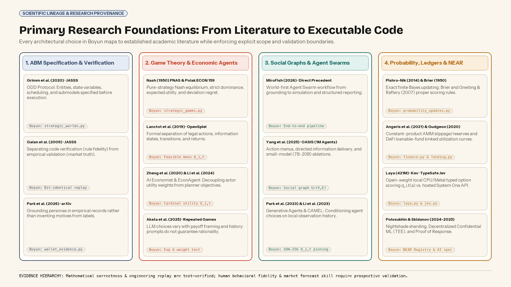
*Figure 2 (scientific-lineage.png) — Primary Research Foundations: Mapping academic literature in ABM specification, Game Theory, Social Graphs, Probability, and NEAR systems to executable Boyun modules.*

- **ABM Specification & Grounding:** Adopts ODD-structured pre-run world specifications ([Grimm et al., 2020](https://www.jasss.org/23/2/7.html)), transactional round updates with bit-identical replay ([Galán et al., 2009](https://www.jasss.org/12/1/1.html)), and empirical record grounding ([Park et al., 2026](https://arxiv.org/abs/2411.10109v3)).

- **Game Theory & Economic Environments:** Combines normal-form equilibrium and regret analysis ([Nash, 1950](https://doi.org/10.1073/pnas.36.1.48); [Polak, Yale ECON 159](https://oyc.yale.edu/economics/econ-159/lecture-5); [Lanctot et al., 2019 — OpenSpiel](https://arxiv.org/abs/1908.09453v1)) with the separation of individual actor utility from planner objectives ([Zheng et al., 2020 — AI Economist](https://arxiv.org/abs/2004.13332v1); [Li et al., 2024 — EconAgent](https://arxiv.org/abs/2310.10436v4)) and repeated-game LLM evaluation ([Akata et al., 2025](https://arxiv.org/abs/2305.16867v2)).

- **Social Graphs & Agent Swarms:** Builds directly on [MiroFish](https://github.com/666ghj/MiroFish)'s world-first Agent Swarm workflow and draws on [Yang et al. (2025 — OASIS)](https://arxiv.org/abs/2411.11581v5), [Park et al. (2023 — Generative Agents)](https://arxiv.org/abs/2304.03442v2), and [Li et al. (2023 — CAMEL)](https://arxiv.org/abs/2303.17760v2) for restricted observation histories and directed message propagation.

- **Market Microstructure & DeFi Credit Mechanics:** Replaces narrative balance changes with executable constant-product Automated Market Maker (AMM) conservation laws ([Angeris et al., 2021](https://arxiv.org/abs/1911.03380v7); [Xu et al., 2023](https://doi.org/10.1145/3570639); cf. [Byrd et al., 2019 — ABIDES](https://arxiv.org/abs/1904.12066v1)) and utilization-based loanable-fund interest and liquidation mechanics ([Gudgeon et al., 2020](https://doi.org/10.1145/3419614.3423254)).

---

## 2. Overview of the Three Formal Fundamentals

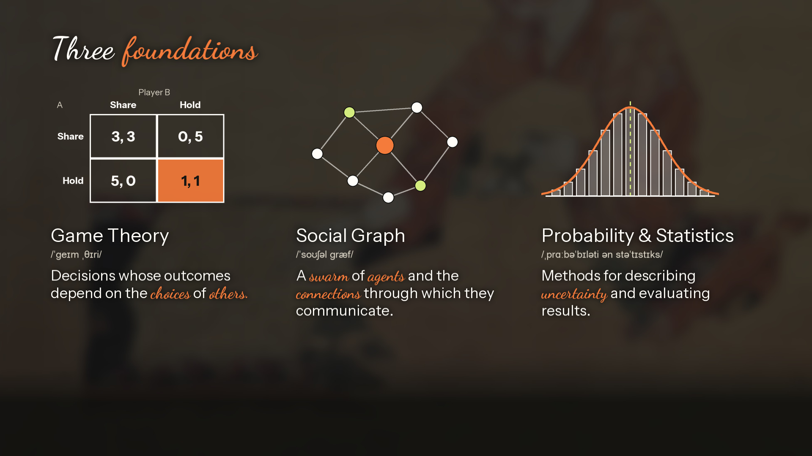
*Figure 3 (foundations.png) — The Three Formal Foundations of a Boyun World: Game Theory, Directed Social Graphs, and Probability & Statistics.*

Before any neural inference call is made, [Boyun-core](https://github.com/Boyun-Protocol/Boyun-core) compiles a decision scenario into a machine-validated **World Specification** governed by three mathematical fundamentals: **Game Theory** (defining who the agents are, what they can afford, and what they value), **Directed Social Graphs** (defining who observes which signal and when), and **Probability & Statistics** (defining how beliefs update, how actions are sampled, and how probabilistic claims are scored).

---

## 2.1 Fundamental 1: Game Theory — Incentives, Feasibility Guards & Equilibrium Kernels

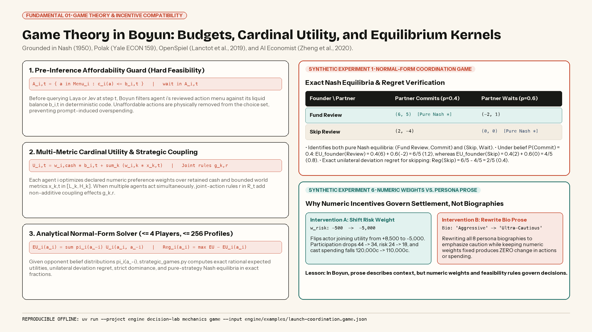
*Figure 4 (fundamental-game-theory.png) — Fundamental 1: Game Theory in Boyun, showing pre-inference affordability guards, cardinal utility weights, and Synthetic Experiments 1 and 6.*

In game theory, strategic interdependence means an actor's payoff depends not only on its own action, but on the profile of actions chosen by others ([Nash, 1950](https://doi.org/10.1073/pnas.36.1.48); [Polak, 2007](https://oyc.yale.edu/economics/econ-159/lecture-2)). However, as recent empirical studies of language models in repeated games demonstrate ([Akata et al., 2025](https://arxiv.org/abs/2305.16867v2)), simply instructing a language model in prose to "be cautious" or "maximize utility" does not guarantee budget adherence or incentive-compatible play.

Boyun embeds game-theoretic structure directly into the runtime across four mechanisms:

1. **Pre-Inference Affordability Guard (Hard Feasibility).** Each agent *i ∈ {1, …, N}* in the swarm holds an explicit pre-decision resource balance *bᵢ,ₜ* (alongside asset inventory, pledged collateral *Q_ℓ*, or credit supply claims *cₛ*). Prior to querying the agent model at step *t*, Boyun filters agent *i*'s reviewed menu *Menuᵢ* in deterministic code to form the affordable choice set: *Aᵢ,ₜ = {a ∈ Menuᵢ : cᵢ(a) ≤ bᵢ,ₜ}*, where *cᵢ(a)* is the integer cost of action *a* and the zero-cost action *wait* is always included. Unaffordable actions are physically excluded before inference so no prompt interpretation can ever overspend.

2. **Multi-Metric Cardinal Utility & Planner Separation.** Following the separation between individual agent utility and system-designer objectives in [The AI Economist (Zheng et al., 2020)](https://arxiv.org/abs/2004.13332v1), each strategic agent *i* is parameterized by explicit numeric preference weights *wᵢ,cash* and *wᵢ,ₖ* over shared state metrics *xₖ,ₜ ∈ [Lₖ, Hₖ]* (such as credibility, participation, or execution risk): *Uᵢ,ₜ = wᵢ,cash · bᵢ,ₜ + ∑ₖ wᵢ,ₖ · xₖ,ₜ*. Utility need not equal financial profit: a protocol founder may weight participation heavily, whereas an institutional liquidity partner weights retained cash and credibility.

3. **Joint-Action Coupling Rules.** Strategic complementarities and bottlenecks are encoded as executable joint-action rules *r ∈ Rₜ*. When a specified subset of agents executes a target action combination in the same round, rule *r* adds a non-additive interaction delta *gₖ,ᵣ* to shared metric *k*.

4. **Analytical Normal-Form Equilibrium & Regret Kernel.** Inspired by [OpenSpiel (Lanctot et al., 2019)](https://arxiv.org/abs/1908.09453v1), Boyun includes an exact normal-form analyzer (*strategic_games.py*) for compact subgames (≤ 4 players, ≤ 256 action profiles). Given declared opponent strategy beliefs *πᵢ(a₋ᵢ)*, it computes exact rational expected utility *EUᵢ(aᵢ) = ∑ πᵢ(a₋ᵢ) Uᵢ(aᵢ, a₋ᵢ)* and unilateral deviation regret *Regᵢ(aᵢ) = max EUᵢ(a') − EUᵢ(aᵢ)* in exact rational fractions, alongside pure-strategy Nash equilibria and strict dominance.

**Experimental Verification (Experiments 1 & 6):** In *Synthetic Experiment 1* (a 2×2 Founder–Partner coordination game where funding a review yields (6, 5) if the partner commits and (−2, 1) if the partner waits), Boyun's solver identifies both pure Nash equilibria—(Fund Review, Commit) and (Skip, Wait)—and under belief *P(Commit) = 0.4* reproduces exact expected utilities *6/5 (1.2)* vs. *4/5 (0.8)* and deviation regret *2/5 (0.4)*. In *Synthetic Experiment 6* (an 8-role world), shifting a single role's numeric risk weight from −500 to −5,000 flips its joining value from +8,500 to −5,000 utility points and cuts cast spending from 120,000¢ to 110,000¢—whereas rewriting all eight persona biographies to emphasize extreme caution while holding numeric weights fixed produces **zero change** in actions or spending.

---

## 2.2 Fundamental 2: Directed Social Graphs — Information Topology Across the Swarm

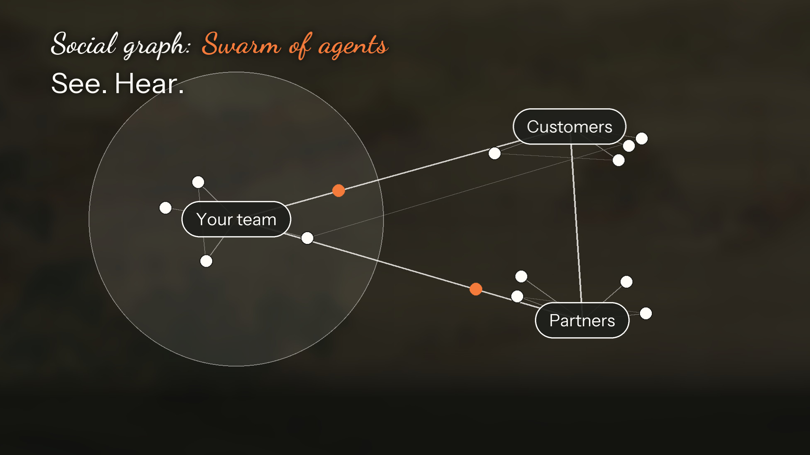
*Figure 5 (social-graph.png) — Directed Social Graph Topology: Connecting the autonomous Swarm of Agents through asymmetric information channels.*

Incentives alone do not determine *who knows what, and when*. In classical game theory, imperfect information is represented via information sets ([Polak, ECON 159 Lecture 18](https://oyc.yale.edu/economics/econ-159/lecture-18)); in modern LLM agent architectures such as [Generative Agents (Park et al., 2023)](https://arxiv.org/abs/2304.03442v2), [CAMEL (Li et al., 2023)](https://arxiv.org/abs/2303.17760v2), [OASIS (Yang et al., 2025)](https://arxiv.org/abs/2411.11581v5), and [MiroFish](https://github.com/666ghj/MiroFish), realistic multi-agent dynamics require conditioning each agent's policy strictly on its local observation history rather than an omniscient global state.

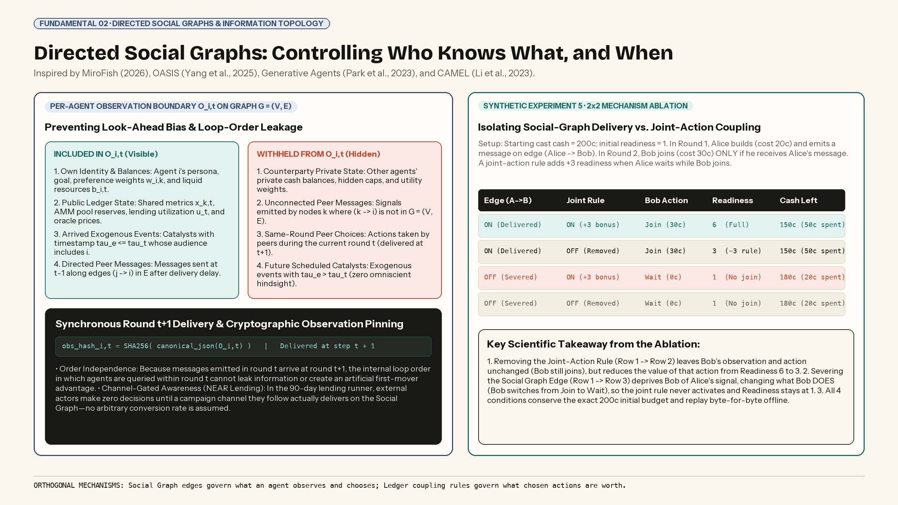
*Figure 6 (fundamental-social-graph.png) — Fundamental 2: Restricted per-agent observation construction Oᵢ,ₜ on G = (V, E), SHA-256 observation pinning, and Synthetic Experiment 5.*

Boyun formalizes communication across the **Swarm of Agents** as a **Directed Social Graph** *G = (V, E)*, where vertices *V = {1, …, N}* are agents and directed edges *(j → i) ∈ E* specify permitted information channels:

- **Restricted Per-Agent Observation Boundary (Oᵢ,ₜ).** At step *t*, the engine constructs a canonical JSON observation *Oᵢ,ₜ* for agent *i* containing only: (1) agent *i*'s own persona, goal, preference weights, and private balances *bᵢ,ₜ*; (2) publicly observable ledger state (shared metrics *xₖ,ₜ*, AMM pool reserves, lending utilization *uₜ*, and oracle prices); (3) exogenous events whose availability timestamp *τₑ ≤ τₜ* has arrived for audience *i*; and (4) peer messages emitted along directed edges *(j → i) ∈ E* whose delivery delay has elapsed. Counterparties' private budgets, hidden preference weights, unconnected messages, and future scheduled catalysts are strictly withheld.

- **Synchronous Round t+1 Delivery & Order Independence.** In round-based strategic worlds, messages emitted by actions in round *t* are delivered to subscribed graph neighbors at the start of round *t+1*. Consequently, the internal software loop order in which agents are queried within round *t* can never leak intra-round actions or create an artificial first-mover artifact.

- **Channel-Gated Awareness & SHA-256 Pinning.** Every constructed observation *Oᵢ,ₜ* is serialized canonically and hashed with SHA-256 before inference, proving exactly what agent *i* observed. In our 90-day NEAR lending runner, external suppliers and borrowers make zero decisions until a campaign channel they follow on the Social Graph actually delivers—eliminating arbitrary conversion-rate guesses.

**Experimental Verification (Experiment 5 — Social Graph Delivery vs. Payoff Coupling Ablation):** In a 2×2 factorial ablation with 200¢ starting cash where Alice builds in Round 1 and sends a message along *(Alice → Bob)*, while Bob joins in Round 2 only if informed and a joint rule adds +3 readiness when Alice waits while Bob joins: removing only the joint rule leaves Bob's choice unchanged (Bob still joins, spending 50¢ total) but lowers readiness from 6 to 3; whereas severing the Social Graph edge *(Alice → Bob)* changes what Bob *does* (Bob selects *wait*, spending 20¢ total) so readiness stays at 1. Thus, Social Graph edges govern what an agent chooses, while ledger rules govern what chosen actions are worth.

---

## 2.3 Fundamental 3: Probability & Statistics — Bayesian Updating, Seeded Sampling & Calibration

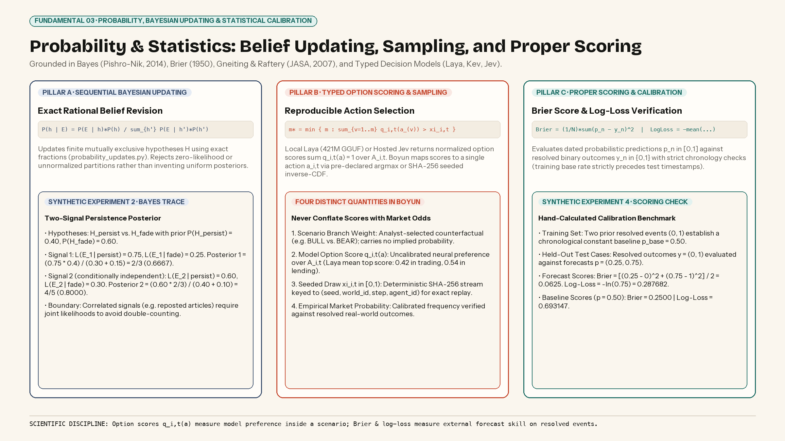
*Figure 7 (fundamental-prob-stats.png) — Fundamental 3: Sequential Bayesian belief updating (Experiment 2), typed option scoring & seeded inverse-CDF sampling, and Brier/log-loss proper scoring rules (Experiment 4).*

Financial and strategic scenarios involve both structural uncertainty over external states of the world and stochastic variation across agent trajectories. Boyun integrates three formal statistical mechanisms while enforcing strict scientific discipline against overclaiming ([Pishro-Nik, 2014](https://www.probabilitycourse.com/chapter1/1_4_3_bayes_rule.php); [Brier, 1950](https://doi.org/10.1175/1520-0493(1950)078%3C0001:VOFEIT%3E2.0.CO;2); [Gneiting & Raftery, 2007](https://doi.org/10.1198/016214506000001437)):

1. **Exact Sequential Bayesian Updating.** For a finite partition of mutually exclusive hypotheses *H*, explicit priors *P(h)*, and conditional signal likelihoods *P(E | h)*, Boyun updates posterior beliefs via Bayes' theorem: *P(h | E) = P(E | h)P(h) / ∑ P(E | h')P(h')* using exact rational arithmetic (*probability_updates.py*). In *Synthetic Experiment 2*, starting from priors (0.4, 0.6) for attention persistence vs. fading, two conditionally independent signals with likelihoods (0.75, 0.25) and (0.60, 0.30) update the persistence posterior to exactly *2/3* and then *4/5 (0.80)*. Boyun explicitly notes that correlated signals (such as reposted articles) require a joint likelihood rather than naive multiplication.

2. **Typed Option Scoring & Seeded Inverse-CDF Selection.** To obtain structured decisions without brittle free-text parsing, Boyun queries typed decision models ([Almeida, 2026 — System One](https://typesafe.ai/blog/introducing-system-one-models-and-jev)) that return normalized option scores *qᵢ,ₜ(a) ∈ [0, 1]* satisfying *∑ qᵢ,ₜ(a) = 1* over the affordable menu *Aᵢ,ₜ*. By default, Boyun runs the open-weight 421M-parameter [Laya model (Convai Innovations, 2026)](https://huggingface.co/convaiinnovations/laya-typed-decisions) locally on CPU/Metal (with architectural compatibility for Qwen-based [Kev](https://github.com/jaredpalmer/kev) and hosted [Jev](https://docs.typesafe.ai/api/system-one)). The engine maps *qᵢ,ₜ(a)* to a concrete action *aᵢ,ₜ* via either deterministic **argmax** or **seeded inverse-CDF sampling**: *m* = min {m : ∑ qᵢ,ₜ(a_(ν)) > ξᵢ,ₜ}*, where *ξᵢ,ₜ ∈ [0, 1)* is drawn from a deterministic SHA-256 stream keyed to *(seed, world_id, step, agent_id)*.

3. **Strictly Proper Scoring Rules (Brier & Log-Loss).** As documented in Laya's model card ([Convai Innovations, 2026](https://huggingface.co/convaiinnovations/laya-typed-decisions)), neural option scores *qᵢ,ₜ(a)* are uncalibrated internal preferences, not empirical market probabilities. Whenever probabilistic forecasts *pₙ ∈ [0, 1]* are evaluated against resolved binary outcomes *yₙ ∈ {0, 1}*, Boyun enforces chronological train/test separation and scores predictions via the **Brier score** *(1/N) ∑ (pₙ − yₙ)²* and **logarithmic loss** ([Brier, 1950](https://doi.org/10.1175/1520-0493(1950)078%3C0001:VOFEIT%3E2.0.CO;2); [Gneiting & Raftery, 2007](https://doi.org/10.1198/016214506000001437)). In *Synthetic Experiment 4*, forecasts (0.25, 0.75) against outcomes (0, 1) reproduce exact Brier (0.0625) and log-loss (0.287682) values against a chronological training baseline (0.25 and 0.693147).

---

## 3. System Architecture, Execution Pipeline & Pluggable Domain Ledgers


*Figure 8 (execution-pipeline.png) — Inside a Single Boyun Simulation Step: Six deterministic verification stages around bounded Swarm Inference.*

At every discrete round or timestamp *τₜ*, Boyun's runtime executes six sequential stages: (1) executing scheduled exogenous events and pre-committed operator plans first; (2) pinning restricted Social Graph observations *Oᵢ,ₜ* with SHA-256; (3) filtering affordable menus *Aᵢ,ₜ* in code (skipping model calls when only *wait* is feasible); (4) querying local *Laya* or hosted *Jev* for normalized option scores *qᵢ,ₜ(a)*; (5) settling selected actions atomically on a pluggable domain ledger; and (6) replaying the saved choice trace offline to verify bit-identical state reproduction.

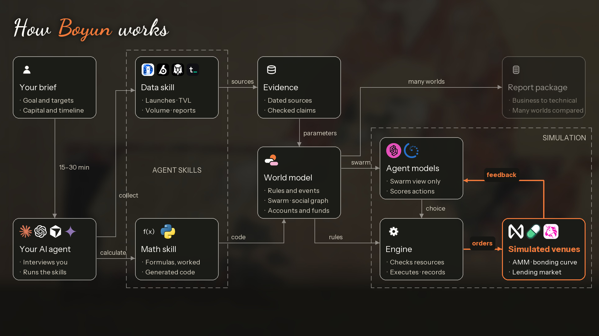
*Figure 9 (architecture.png) — End-to-End Boyun Architecture: From empirical data and math skills to Agent Swarm execution and the 5-Report research package.*


*Figure 10 (math-kernels.png) — Core Mathematical Kernels & Deterministic Ledger Identities implemented and test-verified in Boyun-core.*

As summarized in the mathematical specification card above, Stage 05 supports three pluggable deterministic accounting engines:

- **A. The Strategic & Governance Ledger (strategic_worlds.py).** Deducts integer cash costs *bᵢ,ₜ⁺ = bᵢ,ₜ − cᵢ(aᵢ,ₜ)*, aggregates individual action effects *eₖ(aᵢ,ₜ)* and joint-action coupling terms *gₖ,ᵣ* simultaneously at round end, clamps shared metrics once to *[Lₖ, Hₖ]*, and enforces exact cash conservation *∑ bᵢ,ₜ⁺ + Sₜ⁺ = ∑ bᵢ,₀* (verified in *Synthetic Experiment 3* across two synchronous rounds with 200¢ conserved byte-for-byte).

- **B. The Market Microstructure Ledger (finance.py).** Settles spot swaps against constant-product AMM reserves (*x · y = k*) with fee retention *f* ([Angeris et al., 2021](https://arxiv.org/abs/1911.03380v7)) and virtual-reserve bonding curves ([Pump.fun, 2026](https://github.com/pump-fun/pump-public-docs/blob/main/docs/PUMP_PROGRAM_README.md)): *Δy = y · Δx(1 − f) / (x + Δx(1 − f))*. Atomically rejects orders violating slippage or inventory bounds and separates realized liquid cash from unrealized mark-to-market pool quotes.

- **C. The Collateralized Credit & Liquidation Ledger (lending.py).** Grounded in decentralized loanable-fund mechanics ([Gudgeon et al., 2020](https://doi.org/10.1145/3419614.3423254); [Aave, 2026](https://aave.com/help/borrowing/liquidations)), tracks pool idle cash *Cₜ*, lent principal *Pₜ*, supplier claims *cₛ*, supplier points (1 point per borrowed USDC-day on active unqueued supply), and FIFO withdrawal queues. Evaluates piecewise-linear kinked utilization rates *r(uₜ)*, accrues simple interest on a deterministic *10⁻¹²* USDC downward-rounding precision grid, and computes each loan's health factor *h_ℓ = (Q_ℓ · pₜ · θ) / (D_ℓ · p_usd)* to trigger automated liquidations whenever *h_ℓ < 1.0*.

---

## 4. End-to-End Integration Across the NEAR Protocol Stack


*Figure 11 (near-stack.png) — Boyun x NEAR Protocol Architecture Stack: Deployed Testnet Contracts, Runtime Adapters, and PoC / Architecture Specifications.*

Boyun integrates deeply across the [@NEARProtocol](https://x.com/NEARProtocol) and [@near_ai](https://x.com/near_ai) ecosystem, grounding its architectural roadmap in primary NEAR research—including [Nightshade Sharding 2.0 (Skidanov, Polosukhin & Wang, 2024)](https://discovery-domain.org/papers/nightshade.pdf), [Decentralized Confidential Machine Learning (Polosukhin, Skidanov & Le Guen)](https://github.com/nearai/papers/blob/main/DecentralizedConfidentialMachineLearning.pdf), and [Proof of Response (Polosukhin & Skidanov, 2025)](https://arxiv.org/abs/2502.10637v1):

- **1. NEAR Testnet Commitment Registry [Deployed & Verified]:** Rust (*near-sdk 5.29.1*) smart contract live at *csl-registry-2e4069fc870d.testnet* (code hash *9Fc8Eu3Tj589sxW5oQngK4MqrmTgA2zuaU2JzK1uVcS7*). Registers salted SHA-256 digests *H = SHA256(salt || canonical_bytes)* with RPC finality verification while keeping proprietary scenario text and salt bytes 100% off-chain.

- **2. Intear NEAR Wallet Selector Flow [Implemented]:** Browser wallet flow in *Boyun-interface* and *product_near.py* for inspecting and signing *register_commitment* calls (0.01 testNEAR storage bound, 30 Tgas, automatic excess refund) and exporting private salt opening files.

- **3. NEAR AI Cloud Adapter & Confidential GPU TEE [Implemented Adapter + TEE Spec]:** Pin-verified *NearAITextModel* connector (*https://cloud-api.near.ai/v1*, *x-no-aliasing: true*) paired with our formal verification specification for hardware enclave attestation, TLS key binding, and client-side E2EE world authoring.

- **4. NEAR JSON-RPC Grounding & Native Lending Engine [Implemented & Evaluated]:** Live NEAR RPC state snapshots, dated NEAR TVL ($175M) and [RHEA Finance](https://app.rhea.finance/lending) lending market snapshots (9.88% USDC supply APY, 15.29% borrow APY as of 2026-11-05), and the 90-day NEAR collateral / USDC stress runner.

- **5. NEAR Intents (1Click & Confidential), Chain Signatures (MPC) & Agent Market [PoC & Architecture Specs]:** Post-simulation execution specifications translating a selected Decision Record branch into NEAR Intents 1Click dry-run route quotes (*dry: true*), Confidential Intents treasury settlement, MPC foreign-chain signing, and isolated *IronClaw* workers on NEAR Agent Market.

---

## 5. Practical Modeling Guidelines (Illustrated with the 90-Day NEAR Lending Case)

How should a research or protocol team design a simulation world to extract decision-grade insights without falling into common modeling traps? Below are Boyun's **five core modeling guidelines**, each illustrated directly by what it uncovered in our **90-day NEAR-collateralized USDC lending case study**:

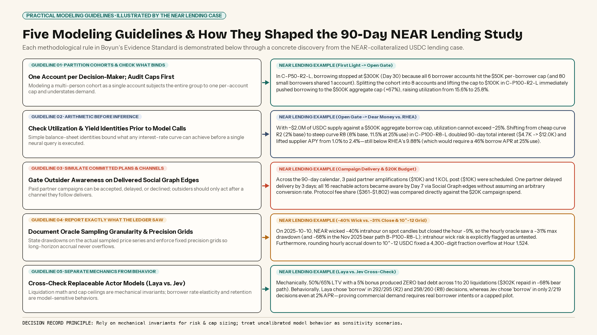
*Figure 12 (guidelines-lending-walkthrough.png) — Five Modeling Guidelines & How They Shaped the 90-Day NEAR Lending Study (First Light -> Open Gate -> Dear Money -> Long Winter).*

1. **Guideline 1 — Partition Multi-Actor Cohorts & Check Which Cap Binds First.** Never model a large group of independent decision-makers as a single account sharing one per-account cap. *NEAR Lending Example:* In our baseline world **First Light (C-P50-R2-L)**, USDC supply reached $1.95M by Day 14 ($1M friendly partners + $700K independent + $110K points looper), but borrowing hit a hard ceiling at **$300K by Day 30** because all 6 borrowing accounts hit their $50K per-borrower cap—even though their pledged NEAR collateral could support $717K at 50% LTV! Worse, an 80-person small-borrower cohort had been represented as a single account with one $50K cap. When we split that cohort into **8 accounts** (7,500 NEAR each) and raised the per-borrower cap to $100K in **Open Gate (C-P100-R2-L)**, borrowing immediately climbed to the **$500K aggregate cap by Day 30** (+67%), lifting peak utilization from 15.6% to 25.8%.

2. **Guideline 2 — Audit Balance-Sheet & Yield Identities Before Running Inference.** Simple arithmetic bounds what any rate curve can achieve before a single model call is made. *NEAR Lending Example:* With ~$2.0M of USDC supply against a $500K aggregate borrow cap, pool utilization cannot exceed ~25%. Under the cheap rate curve *R2* (2% base, 10% at 80% kink), suppliers earned only **~1.0% APY** at 25% utilization. When we tested a steeper curve *R8* (8% base, 15% at 50% kink, 60% max; 11.5% borrow APR at 25% use) in **Dear Money (C-P100-R8-L)**, 90-day borrower interest more than doubled from **$4.7K to $12.0K** (and protocol 15% revenue rose from **$703 to $1,802**), lifting supplier yield to **~2.4% APY**. Yet arithmetic shows that matching [RHEA Finance's](https://app.rhea.finance/lending) live 9.88% USDC supply APY at 25% utilization would require an uncompetitive ~46% borrow rate (9.88% ÷ 0.25 ÷ 0.85). Thus, Boyun proves before launch that either the $500K aggregate cap must be raised or supplier points must carry retention.

3. **Guideline 3 — Execute Committed Campaigns & Gate Outsider Awareness on the Social Graph.** Do not assume an arbitrary marketing conversion rate; model partner acceptance/delays explicitly and activate external actors only when a channel they follow delivers. *NEAR Lending Example:* Across the 90-day calendar, paid partner amplifications ($10K) and a KOL campaign ($10K) were scheduled on the Social Graph. One partner delayed delivery by 3 days, and all 16 reachable actors became aware by Day 7 via directed channel delivery. Comparing the $20,000 campaign spend against the $361–$1,802 90-day protocol revenue immediately highlights the unit-economics gap.

4. **Guideline 4 — Report Exactly What the Ledger Saw (Oracle Granularity & Precision Grids).** Document the exact sampling frequency of your price feed and enforce fixed-point rounding invariants over long horizons. *NEAR Lending Example:* Replaying real hourly NEAR candles from [Binance Spot](https://developers.binance.com/docs/binance-spot-api-docs/rest-api/market-data-endpoints), NEAR wicked −40% intrahour on 2025-10-10 but closed the hour down ~9%, so the hourly-close oracle saw at most a **−31% drawdown** in the choppy window (and **−68%** in the Nov 2025 bear window **Long Winter, B-P100-R8-L**); Boyun flags intrahour wick risk as untested rather than overclaiming. Furthermore, during our first 90-day run, pure rational-fraction hourly interest accrual caused per-supplier receivables to exceed Python's 4,300-digit integer limit at Hour 1,524—motivating Boyun's deterministic **10⁻¹² USDC downward-rounding grid** (where sub-picodollar dust favors borrowers and never creates cash).

5. **Guideline 5 — Separate Mechanical Ledger Invariants from Model-Sensitive Behavior.** Always distinguish conclusions guaranteed by ledger rules from behaviors dependent on an uncalibrated actor model, and cross-check with a second model where possible. *NEAR Lending Example:* Mechanically, 50% max LTV, 65% liquidation threshold, and a 5% liquidation bonus produced **zero bad debt across all runs**—including 20 liquidations repaying $302K during the −68% bear drawdown. Behaviorally, however, local *Laya* chose *borrow* in 292/295 (R2) and 258/260 (R8) offered decisions (showing near-zero rate sensitivity), whereas cross-checking the exact same worlds with hosted *Jev* (**Cold Counter C-P100-R8-J** and **Empty Desk C-P100-R2-J**, $0.059 API cost) produced the opposite extreme: Jev borrowers chose *borrow* in only 2 of 218 decisions even at a 2% base rate, and all 3 paid partners declined amplification.

---

## 6. How to Run Boyun: CLI, Browser Workbench & 15–30 Minute MCP Skills

Boyun is packaged into three modular repositories—[Boyun-core](https://github.com/Boyun-Protocol/Boyun-core), [Boyun-interface](https://github.com/Boyun-Protocol/Boyun-interface), and [Boyun-skills](https://github.com/Boyun-Protocol/Boyun-skills)—supporting headless CLI journeys, an interactive browser workbench with Intear NEAR Testnet Wallet signing, and automated world construction via the [Model Context Protocol (MCP)](https://modelcontextprotocol.io/specification/2025-11-25/architecture):

```bash
# 1. Clone Boyun-core, Boyun-interface, and Boyun-skills
git clone https://github.com/Boyun-Protocol/Boyun-core.git
git clone https://github.com/Boyun-Protocol/Boyun-interface.git
git clone https://github.com/Boyun-Protocol/Boyun-skills.git
cd Boyun-core && uv sync --project engine --extra pdf --dev

# 2. Reproduce the Analytical Game, Bayesian & Calibration Benchmarks Offline
uv run --project engine decision-lab mechanics game --input engine/examples/launch-coordination.game.json --output engine/output/research-game.json
uv run --project engine decision-lab mechanics bayes --input engine/examples/event-belief-update.json --output engine/output/research-bayes.json
uv run --project engine decision-lab evaluate --input engine/examples/evaluation.synthetic.json --output engine/output/research-scores.json

# 3. Launch the Interactive Browser Workbench + Intear NEAR Wallet (http://127.0.0.1:8769)
uv run --project engine --extra pdf --with-editable ../Boyun-interface decision-lab serve --port 8769

# 4. Run the 90-Day NEAR Lending Case Runner with Local Laya ($0 API Fee)
engine/.venv/bin/python engine/tools/run_near_lending_case.py \
  --settings variant-cap100k-steep-settings.json --cast variant-split-cohort-cast.json \
  --calendar variant-split-cohort-calendar.json --path price-path-bear-2025-11.json \
  --out engine/output/near-lending-bear-run

# 5. Start the MCP Server for Claude Code, Codex, Cursor, or Cindy
uv run --project engine --extra mcp decision-lab mcp --workspace engine/output/mcp
```


*Figure 13 (skills-data.png) — Automated Empirical Data Grounding Skill (boyun-world-grounding): Pulling dated NEAR RPC, DeFiLlama, and RHEA DEX evidence.*

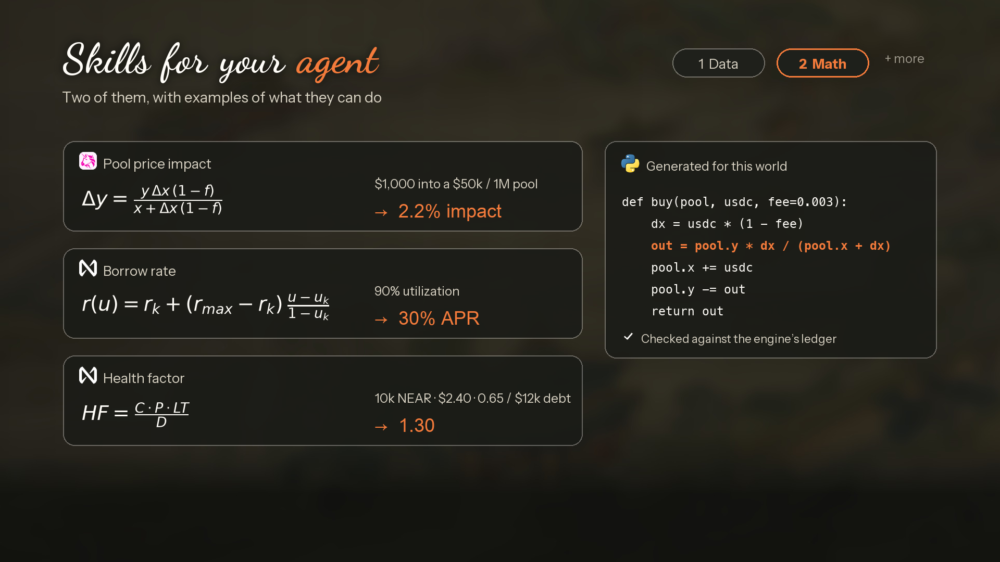
*Figure 14 (skills-math.png) — Automated Mathematical Mechanism Verification Skill (boyun-financial-reports): Auditing conservation laws, AMM impact, and lending health formulas.*


*Figure 15 (report-package.png) — The 5-Volume Boyun Financial Research Casebook: World Creation, Bear Case, Bull Case, Technical Report, and Decision Record.*

---

## 7. Empirical Evaluation: Full-Horizon NEAR Lending & Market Microstructure Studies

Beyond the six synthetic mechanism benchmarks (Experiments 1–6) and 1,918+ automated unit and integration tests, we evaluated Boyun across two full-horizon DeFi case studies executed locally with **Laya** at $0 API cost and a matched-brief comparison with upstream **MiroFish**.

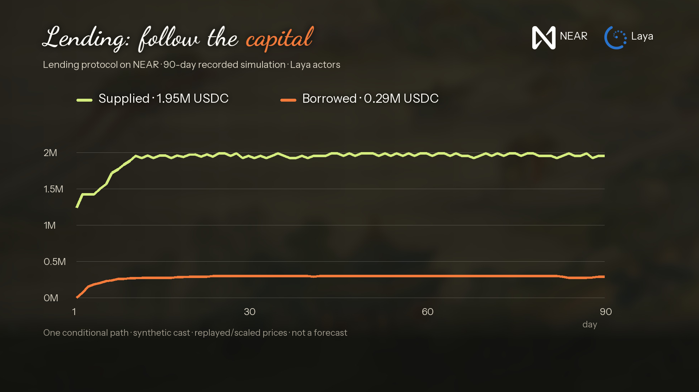
*Figure 16 (lending-paths.png) — 90-Day NEAR-Collateralized USDC Lending Trajectories across supply, borrowed principal, utilization, and collateral drawdowns.*

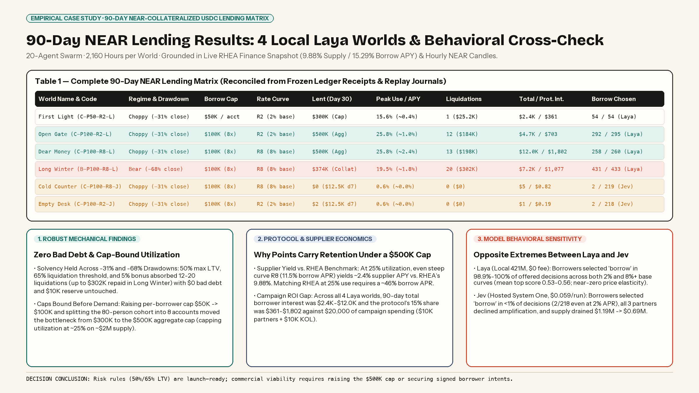
*Figure 17 (near-lending-results-matrix.png) — Complete 90-Day NEAR Lending Results Matrix: 4 Local Laya Worlds (First Light, Open Gate, Dear Money, Long Winter) and 2 Hosted Jev Cross-Check Worlds.*

**Case Study A — 90-Day NEAR Collateralized Lending Matrix (20-Agent Swarm · 2,160 Hours per World):** As detailed in the results matrix above, running four 90-day local *Laya* worlds (*C-P50-R2-L*, *C-P100-R2-L*, *C-P100-R8-L*, and *B-P100-R8-L*) plus two hosted *Jev* cross-check worlds (*C-P100-R8-J* and *C-P100-R2-J*) established four decision-grade conclusions for the launch:

- **1. Solvency Under Severe Drawdowns (Mechanical):** Across both the −31% choppy drawdown (12–13 liquidations, $184K–$198K repaid) and the −68% bear-window drawdown (20 liquidations in *Long Winter*, $302K repaid, $13K liquidator profit, 11 liquidations on Day 40 alone), the 50% LTV / 65% liquidation threshold / 5% bonus parameters produced **zero bad debt** and left the $10,000 protocol reserve 100% intact (contingent on the assumed $200K liquidator cash and hourly exit depth).

- **2. Cap-Bound Utilization & Supplier Yield Ceiling (Mechanical):** Lifting the per-borrower cap from $50K to $100K and splitting the 80-person borrower cohort into 8 accounts moved the binding constraint from $300K to the $500K aggregate borrow cap. With ~$2.0M supplied, utilization is capped at ~25%, limiting supplier yield to ~1.0% APY (R2) or ~2.4% APY (R8) versus RHEA Finance's 9.88% APY.

- **3. Campaign Spend vs. Protocol Fee Revenue (Economic):** Total 90-day borrower interest (collected plus day-90 receivables) ranged from $2.4K (*First Light*) to $12.0K (*Dear Money*), giving the protocol a 15% revenue share of **$361 to $1,802** against **$20,000** in paid campaign expenditure.

- **4. Model Behavioral Divergence (Laya vs. Jev):** Local *Laya* (mean top score 0.53–0.56) borrowed at every opportunity across both 2% and 8%+ base curves, whereas hosted *Jev* (mean top score 0.61) declined amplification and chose *borrow* only 2/218 times even at 2% APR—demonstrating why commercial launch decisions must pair Boyun's mechanical stress tests with signed borrower intents or a capped pilot.


*Figure 18 (price-paths.png) — Case Study B: 14-Day, 24-World Market Microstructure Token Price Trajectories (16-Agent Swarm, 136,841 Local Laya Decisions).*

**Case Study B — 14-Day, 24-World Market Microstructure Matrix & MiroFish Comparison (16-Agent Swarm · 136,841 Local Laya Decisions):** Across a 24-world factorial design (BULL/BEAR × $5K/$10K/$15K founder positions × $5K/$10K upfront costs × *Pause & Observe* vs. *Staged Exit*), Boyun completed all 8,064 path-hours locally at $0 API cost, settling **50,251 filled trades** ($8.49M BULL / $8.28M BEAR) and recording **11,350 atomic slippage rejections**. While *Staged Exit* yielded +$2,736 to +$9,435 more realized liquid cash across all 12 matched pairs at Hour 336, *Pause & Observe* preserved AMM counter-asset reserves and sustained terminal prices of **26.7–117.1 μ$** vs. **10.6–14.7 μ$** under *Staged Exit* (outperforming in 6 of 12 pairs when unsold inventory is valued at terminal pool quotes). Running the exact same brief on upstream **MiroFish** (producing 933 BULL and 577 BEAR free-text posts/quotes with 0 settled trades) confirms that MiroFish and Boyun are complementary: MiroFish explores open-ended social narrative, while Boyun settles deterministic financial consequences.

---

## 8. The Bottom Line & Open-Source Repositories

Boyun's outputs are conditional scenario explorations under explicit ledger rules and declared modeling assumptions—not calibrated market forecasts or financial advice. By uniting **Game Theory**, **Directed Social Graphs**, and **Probability & Statistics** with self-hosted **Laya** inference and verifiable **NEAR Testnet** commitments, Boyun provides an open-source computational laboratory for rigorous economic and protocol decision analysis.

- **Website, Interactive Demo & Research Paper:** [https://boyun-protocol.github.io/](https://boyun-protocol.github.io/)

- **Boyun-core (Engine, Ledgers, CLI, MCP, NEAR Contract):** [https://github.com/Boyun-Protocol/Boyun-core](https://github.com/Boyun-Protocol/Boyun-core)

- **Boyun-interface (Browser Workbench & Intear NEAR Wallet UI):** [https://github.com/Boyun-Protocol/Boyun-interface](https://github.com/Boyun-Protocol/Boyun-interface)

- **Boyun-skills (Empirical Data Grounding & Math/Reporting Skills):** [https://github.com/Boyun-Protocol/Boyun-skills](https://github.com/Boyun-Protocol/Boyun-skills)
