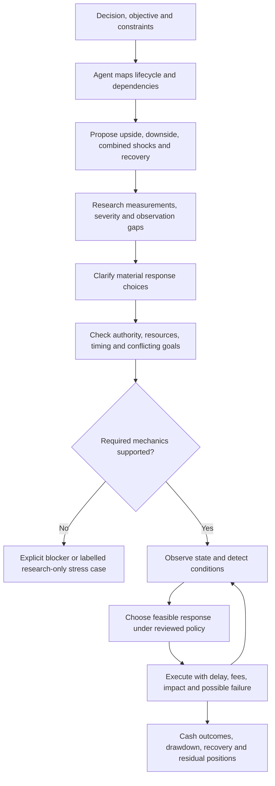

# Lifecycle scenarios and contingent policies

Boyun needs to compare **what a user does as conditions change**, as well as their
initial allocation. The guiding agent must discover these situations from the
product, actors, dependencies and objective. Users should not need to know every
failure mode before starting.

## What changes

| Layer | Required extension | Why it matters |
|---|---|---|
| Guiding agent | Discover relevant stages, shocks and responses proactively | A user will omit unfamiliar failure modes |
| Research | Paths and transition observations, not only current snapshots | Endpoints hide losses, delays and forced exits |
| World construction | Separate protocol state, latent shock, observation and choice | A price level is not proof of migration or successful execution |
| Policies | Conditions, actor control, resources, timing, priority and fallback | An initial plan does not say what to do when several conditions fire |
| Execution | Domain-specific, timestamped settlement and failure behavior | A stop boundary does not guarantee a fill at that price |
| Reporting | Conditional scenarios and policy outcomes, including blocked paths | An average can hide ruin, lockups or a failed recovery |

This is a core modeling extension, not a form redesign. The work can be incremental:
agent discovery first; bounded condition/policy semantics next; then validated domain
execution adapters. A universal financial simulator is not required to ship one
honestly supported use case.

## Define a trigger precisely

| Required decision | Example |
|---|---|
| Metric and source | A specified venue price in USD; circulating cap and FDV remain distinct |
| Reference | Price five minutes earlier, entry price or rolling peak—different conditions |
| Stage | Pre-migration, transition pending or confirmed post-migration |
| Boundary and window | At/below −20% over a declared five-minute reference interval |
| Observation | Cadence, stale-data tolerance, missing-reference handling and detection delay |
| Visibility | Which actor can observe the signal, and when? |
| Repetition | First crossing, persistence, cooldown and rearm/recovery |

For a point-to-point return, `r(t) = P(t)/P(t−window) − 1`. The reference must
exist within a declared tolerance. Peak drawdown requires a different reference.
A missing reference produces **unknown**, not “no event.” Fifteen-minute candles
cannot validate the precise five-minute path; more simulated runs cannot repair
that missing evidence. Hypothetical high-resolution stress paths must be labelled.

Market cap thresholds X/Y may be user policy boundaries. Migration must instead
be confirmed from authoritative protocol state and its actual transition conditions.
Do not hardcode a remembered cap as a launchpad's universal migration criterion.

## Token launch example: proposed branches

These are requirement examples, not probabilities, selected actions or current venue rules.

| Situation | Candidate choices to compare | Important consequence |
|---|---|---|
| Before migration; cap reaches X | Continue, change future spending, take a permitted staged exit | Cash availability and execution remain venue-specific |
| Migration pending/delayed | Wait, defer uncommitted spend, revise pending decisions | Quote/venue identity and action availability may change |
| After migration; cap reaches Y | Hold, staged exit or rebalance within permissions | LP depth and actual proceeds matter more than headline cap |
| Price falls 20% within five minutes | Observe/ask, reduce exposure, pause optional spend, bounded funded response | Detection delay can produce overshoot and failed/partial fills |
| Price falls 50% within an hour | Preserve remaining cash, attempt a feasible exit, compare no intervention | Several triggers may fire; one reserve cannot fund every response |
| Catalyst resolves; attention fades | Reduce future commitments, execute reviewed exit, retain optionality | Private plans stay private; actors react independently |

A buyback is an option to compare only when funded and selected. It is not a default
rescue mechanism or guaranteed recovery. The response changes price, other actors'
incentives and future cash. Paid promotion cannot manufacture independent demand.

## DEX example: same framework, different game

First specify the DEX design: constant-product, concentrated liquidity, order book
or another mechanism. Trader, LP, arbitrageur, treasury and operator have distinct
objectives and control rights. LP profitability is not protocol treasury profitability.

| Branch | Research and state needed | Feasible policy depends on |
|---|---|---|
| Rapid LP exit | Usable depth at trade sizes; active ranges for concentrated liquidity | LP decisions and actual operator controls |
| Rewards expire and capital leaves | Reward schedule, positions, retention and treasury runway | Funded incentives and adverse-selection tradeoffs |
| Routes shift to another venue | Executable quotes, scoped flow, fee/revenue and failures | Actual fee permissions and competitive execution |
| Volatility + LP exit + congestion | Timestamped price/depth paths and transaction delays | Rebalancing constraints, partial execution and response latency |
| Stale data or exploit suspicion | Which data/admin/operational dependencies exist | Only available pause/control rights; recovery evidence |

Do not invent an oracle dependency for a plain AMM or give protocol operators control
of users' LP wallets. A lending product would add collateral, debt, oracle and
liquidation mechanics; the same planning process would expose those requirements.

## Check choices before a run

The agent distinguishes missing definitions, unsupported actions, infeasible budgets,
conflicting goals and untested hypotheses. It explains conflicts and offers choices;
it does not silently rewrite the user's policy.

Check that responses have a payer, authority, observable trigger, available resources,
latency, execution constraints, failure/partial-fill behavior and fallback. Resolve
simultaneous triggers under a declared priority or composition rule. Reserve funds
once, prevent duplicate firing, invalidate stale decisions after transitions, and
specify recovery. Include “do nothing” where feasible and response failure even when
no-intervention is undesirable.

A user demanding a cash exit while forbidding every exit action needs clarification.
A user choosing to hold through stress has a preference to test, not automatically
an invalid strategy. Keep real transaction authorization separate from simulation.

## What the user needs to contribute

1. **Objective and limits:** cash outcome or another goal; horizon; acceptable loss;
   capital that cannot be spent or locked. Ask only for missing constraints.
2. **Rights and private plans:** what the user/team can change, who knows which plans,
   and which commitments already exist. The agent researches public mechanisms.
3. **Policy preferences:** compare alternatives, keep a human decision at a branch,
   or select a conditional simulation policy. The agent proposes concrete feasible
   alternatives with consequences and requests only material unresolved choices.

The agent owns edge-case discovery, evidence planning and identification of missing
mechanics. Users are not responsible for supplying the full scenario catalogue.
Threshold examples are proposed tests until explicitly selected or justified.

## Status and implementation sequence

**Implemented now:** shared stress-discovery instructions reach the single-world
and staged world authors and the scenario-draft request. Local skills, generic
planning templates and the public docs explanation use the same concepts. These
instructions use the existing clarification/limitations contracts; no planning
fields are injected into strict engine inputs.

Two bounded offline runtimes now implement the condition and policy semantics
above. [contingent_worlds.py](../../engine/src/decision_lab/contingent_worlds.py)
evaluates typed conditions over timestamped samples, and
[contingent_policies.py](../../engine/src/decision_lab/contingent_policies.py)
schedules reviewed responses over the firings it returns:

- A sample carries both an event time and an availability time. Nothing may be
  observed before it arrived, so a late correction cannot fire an earlier alert.
- A reference is `prior_sample_window` (point-to-point return), `rolling_peak_window`
  (drawdown) or `window_aggregate` (a fixed early period such as a launch window).
  Absence, a stale newest sample, a reference outside its tolerance and a
  non-positive ratio base are each reported as their own outcome, never as "no event".
- Cadence, persistence, cooldown, rearm and detection delay are separate declared
  controls. `persistence_reset` states explicitly whether unknown or stale ticks may
  bridge a persistent condition.
- A composite condition (`all_of`) fires only when every member's latest evaluation is
  true. A member that is false makes the composite false; a member with no evaluation
  yet, a gap or stale data makes it `unknown_member`, so a conjunction cannot pass just
  because one side is missing. Members are simple conditions on their own series, one
  level deep, so the graph cannot cycle.
- Confirmed lifecycle transitions alone advance a stage; `confirmed: false` records a
  claim. Conditions can be restricted to stages, and a scheduled action can be
  invalidated when a confirmed transition moves the stage before it executes.
- Responses reserve integer pools once (balance to hold, then to spent or back), are
  chosen only from the reviewed ordering for their condition in first-feasible order,
  and simultaneous firings resolve by declared unique priority. Unaffordable work
  records `unfunded`; a latency past the horizon records `pending_at_horizon` and
  releases the funds; a response that would overdraw records `failed_execution`.
- A `human_decision` response suspends new discretionary responses until a supplied
  decision record resolves it, which is the declared form of "pause and ask me".
  The runtime never invents that decision.
- `halts_commitments` plus declared latency models a pause request whose cancellation
  is delayed: commitments that land first stay unavoidable, later ones are cancelled.
  `resumes_commitments` reopens the gate later, so funding can stop and restart.
- A `cancel_pending` response names the actions it releases and takes effect after its
  own latency, which is how "delay the exit while buying continues" is declared rather
  than hard-coded. A cancel effective in the same second as a fill wins that tie by
  declaration; the full same-second order is commitments, triggers, cancellation,
  execution, decisions, and it is reported with every run.
- A 2,000-case randomized sweep of valid plans holds conservation, determinism and
  monotonic event time, including cancel and resume records, and a 1,500-case sweep
  repeating that over composite conjunctions; a structural sweep of 1,884 malformed
  mutations raises `ValueError` with a path in every case. No model call, network read
  or file write occurs in either module.

**Not implemented by this change:** no domain execution adapter yet converts a
response into mechanism-specific trades, fees, partial fills or migration settlement,
so nothing here produces USD profit. The runtimes are not yet wired into the CLI,
workbench UI, MCP tools or the persona decision loop, they do not fetch or verify any
venue observation, and prompt guidance still does not enforce semantic completeness.
The planning JSON in templates/research remains a planning
artifact; it does not compile directly into these schemas.

| Next implementation slice | Acceptance evidence |
|---|---|
| Typed conditions and observation semantics | Implemented offline: exact boundary, window, cadence, gap, stale, out-of-order, same-timestamp, availability and `all_of` conjunction tests in [test_contingent_worlds.py](../../engine/tests/test_contingent_worlds.py) |
| Lifecycle and policy scheduler | Implemented offline: priority, pending action, cooldown, rearm, reservation, transition invalidation, human pause, halt latency, pending cancellation, resumable gate and failed execution in [test_contingent_policies.py](../../engine/tests/test_contingent_policies.py) |
| Domain execution adapter | Mechanism-specific fixtures; conserved cash/tokens; fees, gaps, partial/no fills and permissions |
| Actor decision loop | Decisions use only available observations; valid feasible menus; model call/latency budget; no future leakage |
| Scenario runner and report | Policy comparisons under declared shocks; all blocked paths retained; tail/recovery and residual positions visible |
| Agent integration beyond prompt guidance | Persist reviewed policy plan; enforce capability gates; clarify contradictions; translate only supported rules |
| Wire the runtimes into CLI, workbench and MCP | Packaged example plus isolated installed-wheel run |

Keep the scenario graph bounded: prioritize material branch combinations instead of
constructing every possible sequence. Evaluate numeric conditions in code. Call a
persona model only for a material unresolved choice under the reviewed budget,
not on every price tick. Define behavior when model capacity or budget is unavailable;
never silently change the decision mechanism halfway through a comparison.

Occurrence odds, shock severity, model action judgments, detection and execution
success are separate. Use unweighted named stress cases when occurrence is unknown;
do not invent branch percentages or independence. Comparative runs may replay
matched exogenous shocks, but endogenous liquidity and responses still evolve under
each policy. Report this distinction and do not equate simulation frequency with a
calibrated probability of future profit.

Templates: stress policy plan,
token/DEX examples,
agent process.

Author instruction wiring: [shared guidance](../../engine/src/decision_lab/stress_planning.py)
→ [strategic game construction](../../engine/src/decision_lab/game_construction.py)
→ [single-world author](../../engine/src/decision_lab/strategic_models.py) and
[staged scaffold author](../../engine/src/decision_lab/batch_authoring.py).
The [scenario-draft author](../../engine/src/decision_lab/scenario_authoring.py)
loads the same guidance. [Offline contract tests](../../engine/tests/test_stress_authoring.py)
check delivery, input identity and the existing clarification-only response path;
they do not test live model compliance or financial execution.

Condition and response execution: [contingent_worlds.py](../../engine/src/decision_lab/contingent_worlds.py)
→ [contingent_policies.py](../../engine/src/decision_lab/contingent_policies.py), covered by
[test_contingent_worlds.py](../../engine/tests/test_contingent_worlds.py) and
[test_contingent_policies.py](../../engine/tests/test_contingent_policies.py). Neither is
reachable from the CLI, workbench or MCP yet.
