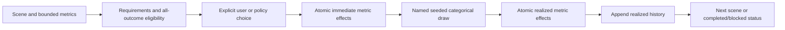

# Interactive choice worlds

Updated 24 October 2026. `choice-world.v1` is implemented in Python, CLI and the
local Studio. It starts a world, lists eligible/disabled choices, applies one
choice, validates a saved history by replay and forks a separate branch. Batches
execute an explicitly supplied ordered policy and summarize every world.

The first example is product-release planning with planning-budget and risk
points. These are declared integer metrics, not conserved cash, positions or
withdrawable funds. The existing explicit-launch adapter remains the financial
simulation. Interactive financial settlement, lending and liquidation are later
mechanics; changing the name of a metric does not implement them.

The earlier design described a future financial story loop. This increment
implements its choice/replay structure using bounded points. The financial
acceptance gates remain in CORE_ROADMAP.md. No additional human
product decision blocks this local increment. Final integrated verification is
pending; this page describes the implemented contract, not completed browser or
installed-wheel acceptance.



## What executes

A package contains exactly `schema_version`, `id`, `event_description`,
`parameters`, `personas`, `metrics`, `scenes`, `initial_scene_id`, `policy` and
`assumptions`. Scene links form a finite acyclic graph. Each metric declares its
unit, initial value, minimum and maximum. Parameters are bounded integers.
Personas declare their role and permitted actions; text causes no inferred
behavior.

A choice supplies its label/explanation, actor, requirements, immediate effects,
outcomes and probability provenance. Only `adjust_metric` executes. A delta or
probability is an integer or an explicit parameter reference. Outcomes include
an ID, label, effects and next scene, with null terminating the world. Every
choice's categorical probabilities sum to 10,000 basis points.

Before a choice is eligible, the engine checks its requirements, immediate
metric changes and every positive-probability outcome against metric bounds.
A possible loss cannot be discarded after drawing. Invalid choices leave state
and history unchanged. A scene with no eligible choices is blocked. Provenance
status, rationale and source references are supplied declarations; an
`estimated` label does not establish measured or calibrated odds.

The random draw is keyed by seed, world ID and scene ID. Action IDs support
idempotency: repeating the same ID with the same choice returns the current
state; reusing it for a different choice fails. Action IDs and branch names do
not change the draw. A fork keeps its source state/history and future scene draws.
Compare alternatives from a snapshot saved before choosing; forking afterward
does not undo the realized history.

## Play in Studio

Start `uv run --project engine decision-lab serve --port 8769` from the repository
root and open the local page. Studio is the default workspace; select **Product
release choices**. Review its field assumptions and supplied behavior. **Explore
outcomes** runs a batch; **Play one world** starts the scene flow. The page shows
eligible choices, disabled reasons, immediate effects, declared outcome odds,
realized outcome, current metrics and immutable history.

Save a snapshot before choosing when you want to compare alternatives. Restore
imports it as a new local session after replay validation; fork creates another
saved branch. A browser refresh can resume its remembered world ID when that
session remains available. Reusing the same server output directory permits
validated lazy loading of persisted world IDs. If an ID is unavailable, explicit
snapshot import remains the recovery route; the UI does not pretend the original
session was recovered. Current draft edits do not alter a world's frozen package.

The web adapter caps persisted choice sessions at 32, uses optimistic revisions
and serializes actions under a lock. Stale actions cannot overwrite newer state;
exact duplicate actions remain safe to retry. Files use private mode0600 and
atomic replacement. A failed save does not advance the committed world.

## CLI and Python

Choose output files that do not exist:

```sh
uv run --project engine decision-lab world start \
  --input engine/examples/choice-world.v1.json --seed 42 --world-id 0 \
  --output engine/output/choice-start.json
uv run --project engine decision-lab world options \
  --input engine/output/choice-start.json --output engine/output/choice-options.json
uv run --project engine decision-lab world step \
  --input engine/output/choice-start.json --choice-id pilot --action-id demo-1 \
  --output engine/output/choice-after-pilot.json
# validate replays the complete snapshot and writes its validated copy.
uv run --project engine decision-lab world validate \
  --input engine/output/choice-after-pilot.json --output engine/output/choice-replayed.json
# Fork the pre-choice state to compare another choice without undoing history.
uv run --project engine decision-lab world fork \
  --input engine/output/choice-start.json --branch-id comparison \
  --output engine/output/choice-comparison.json
uv run --project engine decision-lab scenario run \
  --input engine/examples/choice-world-draft.v1.json --worlds 100 --seed 42 \
  --output engine/output/choice-policy-result.json
```

The pure APIs in `decision_lab.choice_worlds` are `validate_choice_world`,
`start_choice_world`, `choice_options`, `step_choice_world`,
`validate_choice_snapshot`, `fork_choice_world`, `run_choice_policy` and
`choice_world_capabilities`. Inputs are copied; these operations perform no
model, network or wallet call.

## Batch accounting and replay boundary

Each scene's policy is a nonempty ordered list of that scene's choice IDs.
The first eligible listed choice executes. The runtime does not optimize the
policy or invent a fallback. If none of its listed choices is eligible, the world
is blocked even when an unlisted choice could execute. Completed and blocked
worlds both remain in the requested-world denominator, grouped paths and metric
statistics. Reports include status counts, blocked reasons, path counts/shares,
and overall/per-path mean, median and nearest-rank 5th/95th percentiles.

Snapshots contain the full package, seed/world ID, scene, step count, metrics,
history, terminal status, branch metadata and content/engine hashes. Validation
replays history from the explicit input and checks the resulting state. It
rejects an edited metric or inconsistent outcome history; it does not authenticate
author identity, historical ownership, source truth or the probability model.
A different internally consistent input is a different experiment. Engine
identity is part of replay validation; an incompatible snapshot is rejected.

The core bounds input/snapshot bytes, JSON structure, scene/choice/outcome/metric
counts, metric magnitudes, batch work and output. The browser applies stricter
work/export budgets before queueing numerical runs, with at most 100 worlds.
Published capability/limit documents are authoritative for exact current bounds.

## Remaining mechanics

A financial choice must eventually call validated ledger/market operations and
preserve conservation, affordability, liquidity, ownership and settlement rules.
That adapter is not supplied by `adjust_metric`. Richer actor strategies,
information interactions, empirical mappings, a direct authoring provider/chat
and NEAR testnet signing are separately tracked in
CORE_ROADMAP.md. More biographies or model names do not create
those mechanics or a general game-theory solver.
