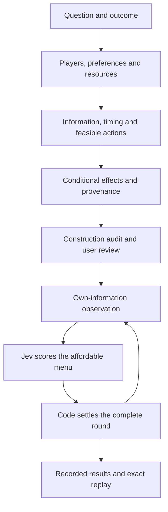

# Construct the game, then the personas

Boyun uses **financial and economic simulation** for its product and research
framing, with game-theoretic goals and incentives for each included actor. A simulation
executes declared incentives and rules; a detailed story does not make the
result representative of people or a calibrated prediction.

## The construction journey

| Step | What the author supplies | Why it exists / consequence of omitting it |
| --- | --- | --- |
| Research question | Intervention, focal actor, horizon, outcome | Otherwise “best” and the comparison have no defined scope. |
| Relevant players | Roles controlling resources, information or effects valued by others | Extra biographies alone do not create strategic interaction. |
| Operational types | Different preferences, endowments, information, actions or links | Two names with identical mechanics may be the same modeled type. |
| Motivation → goal → preferences | Plain-language purpose, terminal objective, signed weights with units and one numerical tradeoff | The narrative and executable objective can otherwise disagree. |
| Feasible menu | Costs, metric effects, preset publication and zero-cost wait | The model must have actual alternatives and cannot spend unavailable cash. |
| Information | Own private context, public state, subscriptions, visible events | Giving every actor the author view would remove the modeled information differences. |
| Timing and interactions | Simultaneous rounds, next-round messages, aggregate bounds, conditional joint effects | Request order must not create advantages; promises need implemented consequences. |
| Provenance and review | Assumed/estimated/model-proposed labels, rationale, sources and missing evidence | Citing a news report does not fit a behavioral coefficient. |
| Execution and comparison | Reviewed world, mode/seed/budget, recorded decisions, replay, sensitivity variants | Otherwise changes in rules, inference and arithmetic are confounded. |

These rules are shared by regular world authoring, scaffold/batched authoring
and the MCP construction resource. The engine accepts the reviewed structured
world. It does not secretly generate its participants or rules during settlement.

## What game theory means here

A **player** is a modeled decision maker. A **type** distinguishes its
preferences, resources, information or feasible options. A **payoff** measures
how that player values an outcome. A **strategy** is a contingent plan across
information states; the current model receives an observation and chooses an
action at each turn. These distinctions follow [Polak, lecture 2](https://oyc.yale.edu/economics/econ-159/lecture-2),
[lecture 15](https://oyc.yale.edu/economics/econ-159/lecture-15) and
[lecture 18](https://oyc.yale.edu/economics/econ-159/lecture-18).

Each actor aims at its own declared terminal weighted utility: retained cash
and shared metrics multiplied by its own signed weights. Units are utility
points per cent or per metric point. Maximization need not mean maximizing
money: an independent reviewer may value credibility and lower operational
risk. The linear function does not model formal risk aversion over lotteries.
“Degen,” “cautious” and “whale” are not executable motives on their own.

A **Nash equilibrium** is a profile in which no actor benefits by changing its
own action alone. Boyun's separate small-game diagnostic can enumerate pure
profiles and test deviations. It does not solve a 100-player dynamic game.
Jev's conditional scores are not equilibrium mixing probabilities. Repeated
rounds, motivational instructions and typed outputs do not guarantee optimal
strategies. [Nash, 1950](https://doi.org/10.1073/pnas.36.1.48).

Private profiles without explicit type priors are not a complete Bayesian-game
specification. The optional Bayesian calculator requires supplied hypotheses,
priors and likelihoods; it does not manufacture beliefs from narrative text.

## Actual eight-role example

Select **NEAR pilot · eight distinct incentives** in the example chooser, or
retrieve `near-pilot-eight-roles` through MCP. This is executable bundled data,
not a screenshot or a proposed future feature.

| Role | Allocated cash | Distinct purpose |
| --- | ---: | --- |
| Founder | $3,000 | Pilot readiness versus publicity and execution risk |
| Treasury steward | $2,000 | Runway, disclosure and reduced risk |
| Liquidity sponsor | $1,500 | Integration readiness and participation; no LP position is created |
| Independent reviewer | $200 | Credibility and lower risk |
| Risk-sensitive retail | $700 | Credible evidence; strong execution-risk penalty |
| Participation-oriented retail | $700 | Strong participation preference; smaller risk penalty |
| Large participant | $1,500 | Larger effort decision, readiness and risk; no whale trade is assumed |
| Ecosystem partner | $400 | Credible reach versus outreach cost |
| **Total** | **$10,000** | **One cast budget, not $10,000 copied eight times** |

Two rounds, four shared hypothetical metrics, 17 total actions including eight
wait options, three conditional joint rules. Initial readiness/credibility/
participation/risk: **20 / 40 / 20 / 40**, each bounded 0–100. All coefficients,
allocations, links and motives are labelled assumptions. The construction
review finds 55 initial objective-sensitive directed dependencies; this count
is a diagnostic of the declared game, not real social-network coverage.

The explicit preference weights are below. Every cash weight is **1 utility
point per retained cent**. Other columns are utility points per hypothetical
metric point; omitted dimensions have weight zero. Magnitudes are deliberately
assumed to express contrasting rankings, not estimated psychological parameters.

| Role | Readiness | Credibility | Participation | Risk |
| --- | ---: | ---: | ---: | ---: |
| Founder | 4,000 | 1,000 | 1,000 | -2,500 |
| Treasury steward | 1,000 | 1,000 | 0 | -3,000 |
| Liquidity sponsor | 3,000 | 500 | 1,000 | -2,000 |
| Independent reviewer | 100 | 2,000 | 0 | -1,000 |
| Risk-sensitive retail | 500 | 2,000 | 100 | -3,000 |
| Participation-oriented retail | 0 | 0 | 3,000 | -500 |
| Large participant | 2,000 | 0 | 1,500 | -2,500 |
| Ecosystem partner | 0 | 1,000 | 1,500 | -1,000 |

These choices create a testable hypothesis: participants with different declared
tradeoffs can react differently to the same shared state. Changing magnitudes is
an assumption-sensitivity experiment; sources do not validate the chosen values.

A participation-oriented join costs 5,000 cents, adds five participation points
and three risk points. Its weights yield `-5000 + 3000×5 - 500×3 = +8500`
utility points in isolation. The risk-sensitive join has the same cost but
adds three participation points and one risk point, yielding
`-5000 + 100×3 - 3000 = -7700`. Other choices and conditional rules can change
what is strategically useful; these partial comparisons exclude them.

The offline baseline joins for the first actor and waits for the second.
Increasing the first actor's risk penalty from -500 to -5000 changes it to
wait, with final participation **44 → 34**, risk **24 → 18**, and total spending
**120,000 → 110,000 cents**. Readiness remains 44 and credibility 98. A prose-only
caution edit leaves this explicitly numeric baseline unchanged. The three
conditions reconcile cash and replay exactly. These are rule-policy results,
not Jev experimental results. Reproduce using the evidence builder; full
inputs, audits and outputs are in [the synthetic record](../whitepaper/evidence/personas.json).

There are no token prices, returns, on-chain transactions, audience estimates,
or observed behavioral coefficients in this example.

## Why Jev is the primary persona model

[TypeSafe's introduction](https://typesafe.ai/blog/introducing-system-one-models-and-jev)
and [official API](https://docs.typesafe.ai/api/system-one) describe a state-in,
typed-answer-out decision model. That fits a finite reviewed action menu.
A separate author model or human constructs the world; **Jev does not produce
world prose, biographies or explanations**. Numeric code enforces the rules.

The current decision contract is `strategic-actor-choice.v2`:

1. The actor sees its own goal, motivation, weights, current cash, public metrics,
   affordable actions, permitted public counterparties, joint rules and delivered
   messages. Peer private preferences and scheduled future-event text are excluded.
2. Code computes each own action's current-stage cash, clamped metrics and utility
   change. It holds other actions fixed and excludes joint effects and later rounds.
3. One native Choice question instructs Jev to pursue its own terminal objective,
   consider visible interactions and remaining horizon, and treat messages as claims.
   It explicitly says the largest partial numeric delta need not be strategically best.
4. Criteria reference action IDs and computed projections; complete action descriptions
   occur once in the state. This removes repeated prose but can enlarge very short requests.
5. The adapter requires complete normalized scores over the feasible menu, a valid top
   label and confidence. It selects argmax or explicitly seeded sampling as reviewed.
6. The record binds the prompt/criteria versions and exact request identity. The
   provider receipt records the actual returned model identity. No extra rationale
   call, hidden fallback or automatic inference retry occurs. Forced wait costs no call.

The model is instructed to maximize expected terminal utility. This is an
objective, not a proof of optimality: it has no inferred numeric belief model
or equilibrium solver. Scores indicate conditional model choices, **not
calibrated event-success probabilities**. Provider efficiency claims are not
independent evidence of persona fidelity or quality relative to frontier models.

## How many actors, and how to optimize

Start with two to isolate one mechanism; use eight to expose distinct incentives.
Ten/twenty can test heterogeneity; fifty/one hundred require a specific coverage
hypothesis, compact menus, sparse subscriptions and reviewed resource allocation.
The maximum supported cast is 100, not an empirically optimal number. Additional
actors are correlated synthetic agents, not independent population samples.

More variants default to detail rather than more capital or influence. The
engine does **not** automatically split cohorts or infer population weights.
Preserve total allocations and review action effects, subscriptions and joint
rules: copying a full-effect action across variants can multiply influence even
if cash totals match. A deliberate population or capital change is a separate
experiment and needs new approval.

Cost counts are actors × rounds × worlds minus forced turns. The eight-role
two-round example needs at most **16 actor requests per world**, while 100 actors
over two rounds need at most **200**. There is no fixed token count per actor.
The product estimates from complete future-prompt growth; authoring is separate.
No new API request was made for this revision.

Next model experiments should compare minimal versus numeric-support prompts,
menu permutations, preference changes, missing/contradictory information, and
Jev versus the disclosed local rule and a larger model. Freeze game/seed/evidence
and track completion, regret on small solvable games, quality, latency and actual
token use. Tune on development cases; keep future outcome data and holdouts out
of prompt selection. We do not yet claim this prompt is empirically optimal.

## Where it is implemented

Stable module/symbol locations are listed here; the generated [source map](SOURCE_MAP.md)
resolves current line numbers and hashes separately from the paper.

- `engine/src/decision_lab/game_construction.py`: shared guidelines; private author
  audit; compact construction summary; isolated own-information actor support.
- `engine/src/decision_lab/strategic_models.py`: author contract, typed questions,
  exact partial projections, decision validation and versioned request identity.
- `engine/src/decision_lab/batch_authoring.py`: construction guidelines for batched
  profiles; frozen economics remain outside persona prose generation.
- `engine/src/decision_lab/data/strategic_examples.json`: executable eight-role example.
- `engine/src/decision_lab/product_api.py`: construction summary bound into run review.
- `engine/src/decision_lab/web/product.js`: expandable construction explanation in
  the existing confirmation step; no redesign of the user journey.
- `engine/src/decision_lab/mcp_adapter.py` and `mcp_server.py`: `inspect_game`,
  `inspect_actor`, and chunked private `game_audit_json` retrieval.
- `engine/tests/test_game_construction.py`: information isolation, counterfactual
  arithmetic, fixed budget, incentive sensitivity and exact replay checks.
- `tools/build_whitepaper_evidence.py`: six offline synthetic experiments, including
  the three-condition eight-role check; no credentials or inference.

## What the decision record can and cannot explain

Jev supplies typed scores and a selected label, with no reasoning trace.
The record preserves the supplied observation, response, action-selection mode,
selected action and numerical settlement. It permits payoff checks and replay.
Declared motivations describe the modeled role; they are not evidence that Jev
used that motivation internally. Code-computed projections show partial numeric
consequences, not the model's deliberation or an optimal-policy proof.

[Broader economic/game research and exact boundaries](ECONOMIC_RELATED_WORK.md).
