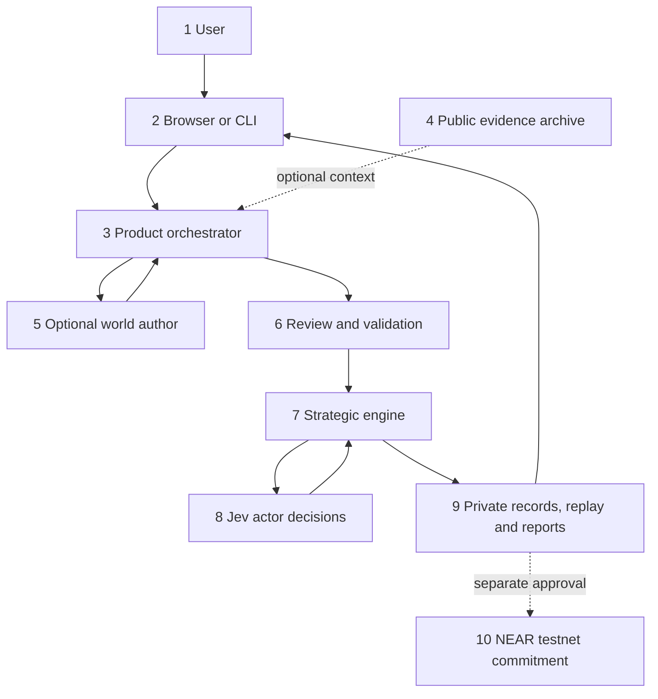
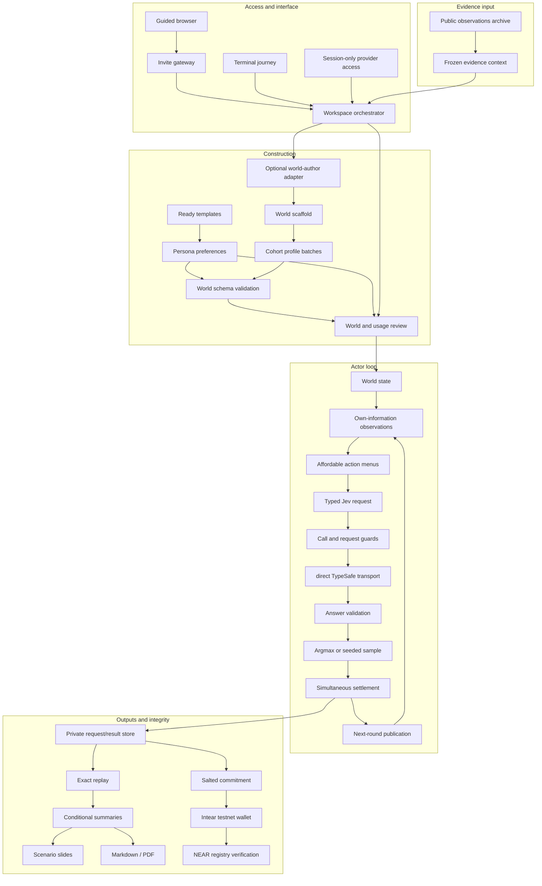
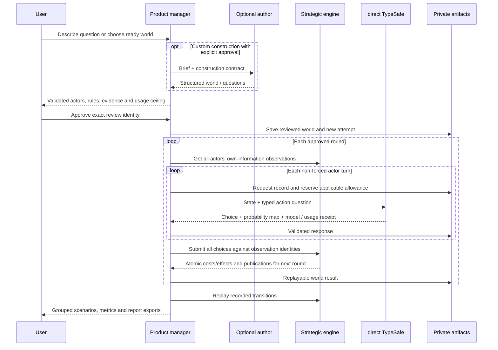

# System design: from a question to a replayable decision experiment

Reviewed 27 October 2026 against implementation baseline
`68585234303887013036fb8026e43c6ab6f59486`. Source links are generated from current
symbols; [SOURCE_MAP.md](SOURCE_MAP.md) is the line-level index. Diagrams describe
**current boundaries**, not an intended all-in-one trading or prediction platform.
[Research foundations](RESEARCH_FOUNDATIONS.md) explains why these mechanisms
exist; [MiroFish provenance](UPSTREAM_REUSE.md) records the fork origin and the
upstream code that was studied rather than reused at runtime.

## Cross-cutting evidence contract

The [shared simulation evidence standard](SIMULATION_EVIDENCE_STANDARD.md) applies
across evidence collection, persona construction, world authoring, execution review
and every output format. Each material assumption and outcome needs a specific
reference or reasonable causal rationale, with a traceable input → mechanism →
outcome chain. The rule is domain-neutral; metrics and mechanics remain domain-specific.

`evidence_planning.py` is the single shared authoring-policy text. Ordinary world
authors, staged scaffolds, profile-only batches, exported author requests and MCP
guidelines receive it. Tests guard delivery without changing strict world schemas.
`simulation_evidence.py` audits sidecar provenance/dependencies; new campaign runs
enforce that audit before dispatch. Other runtimes still require explicit author
review rather than an automatic sidecar admission gate. This boundary must stay
visible as new adapters are added. A source or audit cannot certify behavioral
realism, causality, calibrated forecasts or execution permission.

## 1. Overview: ten components



The author creates proposals, not executable code. Jev selects from a validated
menu; it does not write world descriptions or arbitrarily change balances. The
engine applies rules. The testnet record commits to artifact bytes; it does not
certify that the assumptions or predictions are true.

## 2. Component view: 32 responsibilities

Boxes are logical responsibilities, not 32 microservices or 32 live model calls.
The default implementation is a dependency-light Python application with one
background worker per workspace; it is not OASIS, LangGraph or a distributed
agent compute market.



Interface question sequence: the [interface setup flow](https://github.com/Boyun-Protocol/Boyun-interface/blob/main/src/boyun_interface/assets/product.js). Concrete modules: construction [product_api.py:411](../../engine/src/decision_lab/product_api.py#L411)<!-- code:create --> / [batch_authoring.py:208](../../engine/src/decision_lab/batch_authoring.py#L208)<!-- code:batch -->; review [product_api.py:585](../../engine/src/decision_lab/product_api.py#L585)<!-- code:review -->;
execution [product_api.py:658](../../engine/src/decision_lab/product_api.py#L658)<!-- code:execute -->; records/presentation [scenario_presentation.py:191](../../engine/src/decision_lab/scenario_presentation.py#L191)<!-- code:presentation --> / [product_reports.py:182](../../engine/src/decision_lab/product_reports.py#L182)<!-- code:reports -->;
privacy/access [product_api.py:157](../../engine/src/decision_lab/product_api.py#L157)<!-- code:keys -->; gateway [mvp_preview.py:107](../../engine/src/decision_lab/mvp_preview.py#L107)<!-- code:preview -->. The diagram's next-round loop
stops at the reviewed horizon or failure; it does not run autonomously forever.

## 3. Detail view: 64 responsibilities and checks

Read one group at a time. Each group elaborates a component above; the diagram
is a navigation map, not a claim that all checks are independent services.

```mermaid
flowchart TB
  subgraph Access["A · Entry and access"]
    a1["Question / ready example"] --> a2["Bounded input"]
    a3["Invite code"] --> a4["Origin / session check"]
    a4 --> a5["Reviewer backend"]
    a5 --> a6["CSRF-protected writes"]
    a6 --> a7["Process-only key selection"]
    a7 --> a8["Explicit host disclosure"]
  end
  subgraph Build["B · World construction"]
    b1["Goal and horizon"] --> b2["Persona focus"]
    b2 --> b3["Retail / team motivation"]
    b3 --> b4["Ready template or author"]
    b4 --> b5["Scaffold / actor roster"]
    b5 --> b6["Bounded profile batches"]
    b6 --> b7["Validated merge"]
    b7 --> b8["Required clarifications"]
  end
  subgraph Contract["C · Executable world contract"]
    c1["Actor IDs / roles"] --> c2["Private information"]
    c2 --> c3["Cash / utility weights"]
    c3 --> c4["Costed actions + wait"]
    c4 --> c5["Metrics / bounds"]
    c5 --> c6["Subscriptions / neighborhoods"]
    c6 --> c7["Events / joint-action rules"]
    c7 --> c8["Assumptions / provenance"]
  end
  subgraph Review["D · Dispatch authorization"]
    d1["Complete schema checks"] --> d2["Future prompt growth bound"]
    d2 --> d3["Artifact expansion bound"]
    d3 --> d4["World / route identity"]
    d4 --> d5["Worlds / rounds / seed"]
    d5 --> d6["Actor-call ceilings"]
    d6 --> d7["Operator allowance check"]
    d7 --> d8["Explicit run approval"]
  end
  subgraph Turn["E · One actor turn"]
    e1["Round-state observation"] --> e2["Filter unaffordable actions"]
    e2 --> e3["Build typed Choice criteria"]
    e3 --> e4["Skip forced single action"]
    e3 --> e5["Durable call reservation"]
    e5 --> e6["No-retry Jev POST"]
    e6 --> e7["Validate ID / probabilities"]
    e7 --> e8["Argmax / seeded sample"]
  end
  subgraph Settle["F · Round barrier"]
    f1["Every actor decides"] --> f2["Observation digest check"]
    f2 --> f3["Validate action membership"]
    f3 --> f4["Debit action costs"]
    f4 --> f5["Sum individual + joint effects"]
    f5 --> f6["Clamp metric bounds"]
    f6 --> f7["Publish chosen preset messages"]
    f7 --> f8["Next-round events / visibility"]
  end
  subgraph Record["G · Reproducibility and delivery"]
    g1["Exact world / review files"] --> g2["Requests / responses / receipts"]
    g2 --> g3["Per-world result files"]
    g3 --> g4["Replay with engine identity"]
    g4 --> g5["Requested / completed counts"]
    g5 --> g6["Metrics mean / median"]
    g6 --> g7["Grouped scenario slides"]
    g7 --> g8["Private MD / PDF exports"]
  end
  subgraph Boundaries["H · Separate external boundaries"]
    h1["Public-only source capture"] --> h2["Network-separated SQLite archive"]
    h2 --> h3["Timestamped evidence snapshot"]
    h3 --> h4["Reviewed assumptions"]
    h5["Salt + exact artifact digest"] --> h6["Testnet transaction review"]
    h6 --> h7["Wallet / relayer signature"]
    h7 --> h8["Finality / code / receipt check"]
  end
  a2 --> b1
  a8 --> b4
  b8 --> c1
  c8 --> d1
  d8 --> e1
  e4 --> f1
  e8 --> f1
  f8 --> e1
  f8 --> g1
  h4 --> b4
  g8 --> h5
  e6 -. error: stop and preserve records .-> g2
```

<details>
<summary>Expand the detailed execution and evidence map</summary>



</details>

## 4. Timing and communication



Actor HTTP calls are sequential in the current worker, but decisions share the
same pre-settlement round state. A later actor cannot read an earlier actor's
same-round decision. Messages are the **chosen action's preset publication**,
delivered to subscribers in subsequent rounds. Jev does not produce free-form
messages. No independent persona process, blockchain agent or external tool
permission is created just because we call a role an agent. See [strategic_models.py:105](../../engine/src/decision_lab/strategic_models.py#L105)<!-- code:decide --> and
[strategic_worlds.py:287](../../engine/src/decision_lab/strategic_worlds.py#L287)<!-- code:world_advance -->. A failure stops the run without hidden retry/fallback; an
already dispatched remote call cannot be recalled.

## 5. Interfaces and artifacts: what, why, who consumes it

| Touch point / artifact | Producer → consumer | Why it exists |
| --- | --- | --- |
| Question + persona preferences | User → interface/author | States decision and intended viewpoints; changing detail must not create capital |
| Structured proposal / clarification | Author or ready template → user/validator | Makes assumptions and executable rules reviewable before paying for actor inference |
| `strategic-world.v1/v2` | Author/import → engine | Data-only contract; bounded actors, actions, metrics, events, interactions and visibility |
| Review identity + selected route + caps | Product manager → dispatch | Binds approval to this world/model/configuration and budget |
| `state` + `questions.action` | Observation builder → direct TypeSafe | Gives only permitted context and action criteria; no arbitrary action text |
| Typed Choice answer + receipt | Provider → validator/selector | Checks support/normalization; preserves reported model, token usage and input-cost estimates |
| `action_id` + observation digest | Selector → engine | Rejects stale, wrong-world, unknown or unaffordable decisions |
| `world.json`, `review.json`, call request/response files | Worker → private store | Retains exact inputs and evidence of completed/uncertain dispatch |
| `world-N.json`, `state.json`, `status.json` | Engine/worker → replay/report | Reconstructs transitions and preserves partial runs and denominators |
| Slides / MD / PDF | Presentation layer → user | Summarizes completed paths, costs and unknowns without inventing an analyst narrative |
| `allowance.json` | Preview guard → future dispatch | Persistent conservative reviewer allowance; not actual provider billing or customer money |
| Public source snapshot | Collector/archive → evidence context | Keeps source/network/time/gaps separate from inferred motives or calibrated effects |
| Salted commitment + private opening | Integrity module → wallet/registry/user | Allows exact-file integrity checking while keeping scenario/salt off chain |

Concrete authorization and identity: [product_api.py:585](../../engine/src/decision_lab/product_api.py#L585)<!-- code:review -->, [product_api.py:621](../../engine/src/decision_lab/product_api.py#L621)<!-- code:run -->; wire/validation:
[jev.py:209](../../engine/src/decision_lab/jev.py#L209)<!-- code:jev -->; settlement/replay: [strategic_worlds.py:287](../../engine/src/decision_lab/strategic_worlds.py#L287)<!-- code:world_advance -->, [strategic_worlds.py:339](../../engine/src/decision_lab/strategic_worlds.py#L339)<!-- code:world_replay -->;
allowance: [preview_budget.py:81](../../engine/src/decision_lab/preview_budget.py#L81)<!-- code:allowance -->; report construction: [scenario_presentation.py:191](../../engine/src/decision_lab/scenario_presentation.py#L191)<!-- code:presentation -->.

## 6. World and actor contracts

A strategic world contains:

```text
id, title, description, rounds
metrics[]: id, label, unit, initial, min, max, provenance
actors[]: id, name, role, motivation, goal, information,
          initial_cash_cents, utility_weights,
          actions[], subscriptions[], provenance
actions[]: id, label, description, cost_cents, effects, message, provenance
events[]: id, round, text, effects, visible_to, provenance
interactions[]: id, when{actor:action}, effects, description, provenance
assumptions[], limitations[]
```

Executable examples are in
[strategic_examples.json](../../engine/src/decision_lab/data/strategic_examples.json).
`wait` must be silent, zero-cost and have no effects. Actions and weights are
explicit proposed inputs, not engine-generated biographies or unbounded code.
Events in this strategic contract are **scheduled**, not probabilistic branches.
The separate event-chain module handles supplied stochastic branch weights.

For v2: 2–100 actors, 1–8 rounds, 1–8 public metrics, 2–8 actions per actor,
up to 16 joint rules and 32 events. Sparse public neighborhoods and subscriber
fanout are at most 12 per actor. Product runs allow 1–4 sampled worlds but at
most 800 actor-turn calls, with future-input and serialized-output budgets that
may reject a nominally valid actor count. See [strategic_worlds.py:85](../../engine/src/decision_lab/strategic_worlds.py#L85)<!-- code:world_validate --> / [product_api.py:585](../../engine/src/decision_lab/product_api.py#L585)<!-- code:review -->.
Batched authoring is one scaffold plus cohorts of at most 20 profiles; the
six-call construction ceiling does not cap every possible revision's USD cost.

A Jev request has the form:

```json
{
  "state": {"actor": "own profile and permitted facts", "actions": "affordable menu"},
  "questions": {
    "action": {
      "type": "choice",
      "instructions": "Choose the permitted action matching this actor and context.",
      "criteria": {"a0": "wait", "a1": "a reviewed costed action"}
    }
  },
  "model": "jev-latest"
}
```

This abbreviated wire illustration is not a valid full engine observation.
[strategic_models.py:75](../../engine/src/decision_lab/strategic_models.py#L75)<!-- code:decision_request --> builds the actual request. [jev.py:209](../../engine/src/decision_lab/jev.py#L209)<!-- code:jev --> validates a full Choice
probability map. The native adapter supports Choice and Noul; the strategic actor loop uses
Choice. Free model-catalog checks are separate explicit GETs, not inference. Details: [Jev contract and failures](JEV_INTEGRATION.md).

## 7. Three execution families, not one opaque engine

| Family | Implemented responsibilities | Integration limit |
| --- | --- | --- |
| Strategic product, default `/` | Model actor choices; goals/private views; scheduled events, shared metrics, joint effects; slides/replay | No trading venue, token valuation, borrowed capital or realized token-sale profit |
| Financial lab / financial agent CLI | Conserved ledger/AMM, attention and campaigns, financial role decisions, liquidity/exit worksheet, controlled subscription experiments | Separate world schema; not automatically used by a strategic UI result |
| Standalone analytical/event modules | Exact finite games, explicit Bayesian updates, event chains, matched numeric comparisons, forecast scoring | Small-game bridge enters strategic diagnostics; Bayes/scoring/social modules are not silently run in every product session |

Financial settlement: [finance.py:93](../../engine/src/decision_lab/finance.py#L93)<!-- code:ledger --> / [finance.py:182](../../engine/src/decision_lab/finance.py#L182)<!-- code:amm -->; financial live role orchestration:
[agent_orchestration.py:125](../../engine/src/decision_lab/agent_orchestration.py#L125)<!-- code:finance_live -->; branches: [event_chains.py:240](../../engine/src/decision_lab/event_chains.py#L240)<!-- code:event -->; Bayesian arithmetic: [probability_updates.py:103](../../engine/src/decision_lab/probability_updates.py#L103)<!-- code:bayes -->;
forecast scoring: [evaluation.py:146](../../engine/src/decision_lab/evaluation.py#L146)<!-- code:evaluation -->. Avoid copying numeric “profit” from one family
into utility/attention charts in another. There is no automatic newspaper/social
scraping or statistically fitted persona pipeline joining all families.

## 8. Evidence and persona construction

The product accepts ready authored personas, optional model-authored proposals
and imported validated worlds. The original role library is not an observed
population sample. [persona_controls.py:15](../../engine/src/decision_lab/persona_controls.py#L15)<!-- code:persona --> changes motivations/roles for selected viewpoints;
it does not alter cash, utility weights, action costs or information links.
[Persona controls](PERSONA_CUSTOMIZATION.md) describes those effects.

[wallet_evidence.py:119](../../engine/src/decision_lab/wallet_evidence.py#L119)<!-- code:wallet_data --> builds descriptive cohorts from one network's sampled trades.
[public_archive.py:167](../../engine/src/decision_lab/public_archive.py#L167)<!-- code:archive --> preserves public observations and failures. NEAR and Solana remain
separate. [near_demo.py:58](../../engine/src/decision_lab/near_demo.py#L58)<!-- code:near_case --> freezes NEAR context into a reviewed starter, with
assumptions preserved. Unknown wallet identities, holdings, source coverage and
causal motivations remain unknown. There is no fitted KOL/market-maker classifier
or guarantee of a full 30-day history.

## 9. Deployment, privacy and NEAR

```text
Invited browser -- HTTPS/tunnel --> loopback invite gateway
                                   |-- reviewer A backend + private files
                                   |-- reviewer B backend + private files
                                   `-- reviewer C backend + private files
Each backend -- explicit provider request --> direct TypeSafe / optional author
Result -- separate testnet approval --> NEAR registry
```

The host can read keys in process memory and artifacts on disk. HTTPS protects
transport, not against that host. BYOK changes account/billing control, not host
visibility. Optional NEAR AI authoring does not put Jev requests inside a TEE;
our adapter verifies no inference attestation. Full data never belongs on chain.

[integrity.py:44](../../engine/src/decision_lab/integrity.py#L44)<!-- code:commitment --> creates a salted exact-artifact commitment. [product_near.py:69](../../engine/src/decision_lab/product_near.py#L69)<!-- code:wallet --> prepares
the wallet transaction; [near_registry.py:147](../../engine/src/decision_lab/near_registry.py#L147)<!-- code:verify --> checks expected contract code and transaction
result/finality. The on-chain write method is [lib.rs:42](../../contracts/commitment-registry/src/lib.rs#L42)<!-- code:contract -->; it records the salted commitment and public submitter/block metadata. An actual operator-signed testnet result is recorded in
[NEAR_MVP.md](NEAR_MVP.md). External-wallet signature and funded Cloud author
acceptance remain distinct gates. No Intents, Chain Signatures, agent escrow,
mainnet execution or blockchain-based correctness of model reasoning is claimed.
See public-test plan and [privacy setup](PRIVATE_ONBOARDING_CLI.md).

## 10. Why these choices / what they cost us

- A data-only kernel keeps authors/models replaceable and state transitions
  inspectable. It limits scenarios to supported actions and effects.
- Simultaneous rounds prevent request-order leakage. They do not reproduce
  continuous exchange time, arbitrary network delay or asynchronous negotiation.
- Sparse neighborhoods bound prompts and cost. They impose an explicit
  information model rather than representing an entire social platform.
- Recorded replay supports debugging and integrity. It cannot replay an unseen
  provider decision or establish truth of its messages.
- No automatic fallback/retry preserves cost/route meaning. A failure interrupts
  the user and may leave uncertain remote usage requiring reconciliation.
- Optional testnet commitments make records portable to verify. They add a wallet
  step and public signer metadata, without improving prediction accuracy.


## Documentation verification

All six Mermaid blocks across this document, the root README and provenance
ledger were parsed and rendered with Mermaid 11.12.0 during this review. The
three system views contained 10, 32 and 64 nodes. The browser caught a sequence
syntax error caused by a semicolon in a message; the final source renders.
The temporary renderer used public/synthetic diagrams only and is not a product
runtime dependency. Source anchors/relative paths pass the offline builder.
The documented game/Bayes/scoring examples ran with external connections blocked.
These checks validate the documentation and examples, not empirical forecasts.
