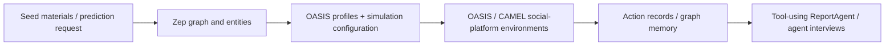

# MiroFish, OASIS and our own implementation: provenance ledger

Reviewed 27 October 2026, packaging change recorded 31 October 2026. Boyun began
as an **AGPL MiroFish fork**, not an independently invented copy of its product
concept. Starting source:
[666ghj/MiroFish](https://github.com/666ghj/MiroFish/tree/7657031ac01184afe2cb220f5ee3545573b5e843),
commit `7657031ac01184afe2cb220f5ee3545573b5e843`.
The user's pre-existing modified checkout was left alone. This separate checkout
originally used `feat/crypto-core`. On 28 October 2026 the owned fork was published
at [nvq2309/boyun-protocol](https://github.com/nvq2309/boyun-protocol), with
`near-dev` as its default branch and `origin` remote. `upstream` retains MiroFish.

## What ships now, and what changed on 2026-10-31

The fork's release package no longer contains the upstream application: the Flask
`backend/`, the Vue `frontend/`, their OASIS/CAMEL runners, the Zep graph/entity/
profile pipeline, the upstream npm package and the archived upstream READMEs were
deleted. They were never imported or launched by `decision-lab serve`, so shipping
them meant distributing attack surface, a second dependency tree and a second
product identity for no runtime benefit. The pin above stays the provenance point,
and this document keeps what was read there.

| Item | Status in this package | Status in the Boyun runtime |
| --- | --- | --- |
| Original repository, Vue frontend, Flask backend | Removed 2026-10-31; retained in upstream history at the pinned commit | Not imported or launched by `decision-lab serve` |
| Upstream OASIS/CAMEL integration and runners | Removed with the backend, pins included | Not a Boyun dependency |
| Zep graph/entity/profile pipeline | Removed with the backend | No Zep/GraphRAG memory service in our engine |
| Profile/configuration/report prompts | Removed with the backend | No claim that these prompts drive the Jev engine |
| AGPL license and original attribution | Kept in [LICENSE](../../LICENSE), [NOTICE](../../NOTICE) and this ledger; engine declares AGPL-3.0-only | Applies to our publication; do not remove notices |
| Seed → personas → simulation → report workflow | Important product/design precedent | Adapted as question → reviewed world → bounded choices → replayed scenarios |
| Social observations and model-controlled action menus | Important architectural precedent | Independently implemented with our own schemas and visibility/settlement rules |
| Strategic UI, CLI, Jev adapter, numeric kernels and NEAR registry | The shipped product, under engine/, tools/ and contracts/ | Actual implementation of Boyun |

Before the removal, `git diff --name-only 7657031ac01184afe2cb220f5ee3545573b5e843 -- backend frontend`
returned no paths, which established source retention, not dependency correctness
or successful upstream execution. The shipped package has no production Python
library dependency; PDF export is optional ReportLab. It needs no npm, Vue, Flask,
OASIS or Zep setup. See [engine/pyproject.toml](../../engine/pyproject.toml).

## How MiroFish's system works

This is the upstream conceptual flow, not our execution graph. The links below go
to the pinned commit, because those files are no longer in this checkout. Our
inspection of them supports the following touch points:

| Upstream code at the pinned commit | What it does | What we take / do differently |
| --- | --- | --- |
| [graph_builder.py:61](https://github.com/666ghj/MiroFish/blob/7657031ac01184afe2cb220f5ee3545573b5e843/backend/app/services/graph_builder.py#L61) | Builds/queries graph content through Zep | Evidence context should be explicit; we use frozen labelled snapshots rather than importing that service |
| [oasis_profile_generator.py:274](https://github.com/666ghj/MiroFish/blob/7657031ac01184afe2cb220f5ee3545573b5e843/backend/app/services/oasis_profile_generator.py#L274) | Builds an entity context, chooses LLM/rule profile generation, returns descriptive/social fields | Context before profile generation is useful; our actor contract additionally requires money, actions, utility, information and provenance |
| [simulation_config_generator.py:244](https://github.com/666ghj/MiroFish/blob/7657031ac01184afe2cb220f5ee3545573b5e843/backend/app/services/simulation_config_generator.py#L244) | Derives simulation configuration from context/entities | Construction remains separate from execution; our bounded scaffold/cohort merge is [batch_authoring.py:208](../../engine/src/decision_lab/batch_authoring.py#L208)<!-- code:batch --> |
| [Twitter environment creation](https://github.com/666ghj/MiroFish/blob/7657031ac01184afe2cb220f5ee3545573b5e843/backend/scripts/run_twitter_simulation.py#L592) | Creates an OASIS Twitter environment with an agent graph and DB | We use a bounded strategic state machine, [strategic_worlds.py:287](../../engine/src/decision_lab/strategic_worlds.py#L287)<!-- code:world_advance --> |
| [LLMAction round dispatch](https://github.com/666ghj/MiroFish/blob/7657031ac01184afe2cb220f5ee3545573b5e843/backend/scripts/run_twitter_simulation.py#L649) | Activates social agents and steps their actions through OASIS | We call [strategic_models.py:105](../../engine/src/decision_lab/strategic_models.py#L105)<!-- code:decide --> from the product worker, enforcing typed action support and explicit cost ceilings |
| [report_agent.py:872](https://github.com/666ghj/MiroFish/blob/7657031ac01184afe2cb220f5ee3545573b5e843/backend/app/services/report_agent.py#L872) | Accesses graph/search/interview tools for report construction | Our principal results come from recorded engine data, [scenario_presentation.py:191](../../engine/src/decision_lab/scenario_presentation.py#L191)<!-- code:presentation -->; Jev does not write a prose analysis |

Upstream profile defaults include randomly supplied social counts when absent;
these are not observed wallet balances or calibrated population parameters. We
do not transfer those values into financial behavior. Original service retries
and rule fallbacks do not become hidden fallbacks in our model route.

## What OASIS contributes, precisely

[OASIS's research paper, v5](https://arxiv.org/html/2411.11581v5), and
[official implementation](https://github.com/camel-ai/oasis) describe a social
platform simulator with agents, social actions, recommendation and dynamic
state. MiroFish wraps this environment using CAMEL models and generated profiles.
The pinned upstream backend declared `camel-oasis==0.2.5` and `camel-ai==0.2.78`.
Those pins are not a statement that today's upstream OASIS API/action count is
identical. Our comparison is to that pinned code, not an invented benchmark.

We take these lessons: interactions need an environment; a persona needs visible
context; permitted actions must be explicit; outputs should be inspectable.
Our replacement chooses sparse subscriptions, synchronous rounds, data-only
cost/effect rules and a typed decision model. **We have not ported OASIS's
recommendation algorithms, platform databases, million-agent scale or empirical social-propagation experiments.** Neither did we keep its
source integration, so those features are absent from Boyun by construction.

## What is original to this fork, and what remains unintegrated

Current code: [strategic_worlds.py:85](../../engine/src/decision_lab/strategic_worlds.py#L85)<!-- code:world_validate --> / [strategic_worlds.py:255](../../engine/src/decision_lab/strategic_worlds.py#L255)<!-- code:world_observe --> / [strategic_worlds.py:287](../../engine/src/decision_lab/strategic_worlds.py#L287)<!-- code:world_advance -->,
[jev.py:209](../../engine/src/decision_lab/jev.py#L209)<!-- code:jev -->, [strategic_games.py:126](../../engine/src/decision_lab/strategic_games.py#L126)<!-- code:game -->, [probability_updates.py:103](../../engine/src/decision_lab/probability_updates.py#L103)<!-- code:bayes -->, [finance.py:93](../../engine/src/decision_lab/finance.py#L93)<!-- code:ledger --> / [finance.py:182](../../engine/src/decision_lab/finance.py#L182)<!-- code:amm -->, [evaluation.py:146](../../engine/src/decision_lab/evaluation.py#L146)<!-- code:evaluation -->,
[integrity.py:44](../../engine/src/decision_lab/integrity.py#L44)<!-- code:commitment --> / [near_registry.py:147](../../engine/src/decision_lab/near_registry.py#L147)<!-- code:verify -->. Exact line numbers for every symbol are in the
generated [source map](SOURCE_MAP.md). These implement different contracts and
should not be represented as new upstream MiroFish features.

The strategic UI and financial AMM are separate execution families. Zep memory,
OASIS environment integration, automated news ingestion, empirical wallet-to-motive
fitting, general bargaining/repeated-game equilibrium and public paid hosting
are not completed by this documentation. See [system design](SYSTEM_DESIGN.md).

## Attribution and publication

Keep [LICENSE](../../LICENSE), [engine/LICENSE](../../engine/LICENSE), the
[NOTICE](../../NOTICE) and bundled asset/library notices, including Manrope and the
wallet SDK. The package's declared license is [AGPL-3.0-only](../../engine/pyproject.toml).
A public release should expose the corresponding source under the applicable
license terms and visibly identify MiroFish as the project Boyun forked from.
The owned source is now public; do not push our product to 666ghj's upstream
remote or imply their endorsement. Third-party API service
permission and asset rights are separate from the source-code license.
